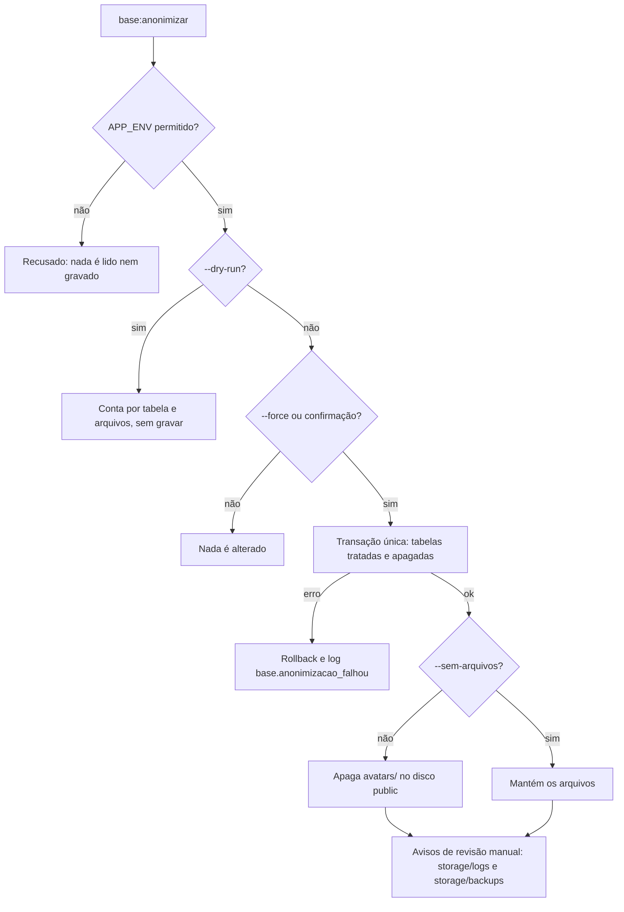

# Anonimização de bases não produtivas

> **Status:** código pronto na integração da Onda 2 (`feat/onda-2-lgpd-lote-2`, release 1.7.0). O processo de uso ainda não foi aprovado: ver T-41 no [backlog](../backlog.md).
> **Comando:** `base:anonimizar`. **Código:** `app/Console/Commands/BaseAnonimizarCommand.php`, `app/Services/AnonimizacaoDeBaseService.php`, `app/Repositories/AnonimizacaoDeBaseRepositoryDb.php` e `config/anonimizacao.php`.

> **Atenção: a operação é irreversível.** O comando troca dados pessoais do banco por valores neutros, e não há desfazer depois do commit. Ele só roda em ambientes não produtivos, mas não sabe se a base é de teste: antes de rodar, confirme o `APP_ENV` com `app:check-env` (ver [deploy e segredos](./deploy-e-segredos.md)) e confirme que a base é de teste.

## 1. Para que serve

Prepara uma base de desenvolvimento ou de staging sem dado pessoal real. As diretrizes T-01 e T-03 (ambientes de desenvolvimento só com dados sintéticos ou anonimizados) seguem diferidas pelo responsável. Este comando é o caminho técnico para essa decisão, e não a decisão em si.

## 2. Guardas de execução

| Verificação | Resultado |
|-------------|-----------|
| `APP_ENV` = `production` | Recusado, mesmo com `--dry-run` |
| `APP_ENV` fora de `local`, `development`, `staging` e `testing` (`anonimizacao.ambientes_permitidos`) | Recusado, mesmo com `--dry-run` |
| Sem `--force` e sem terminal interativo | Recusado: a operação pede `--force` |
| Sem `--force`, com terminal | Pede confirmação; a resposta padrão é não |
| `--dry-run` | Conta, por tabela, o que mudaria. Não grava nada e não apaga arquivos |
| Erro durante a execução | A transação é desfeita e nenhum dado do banco muda. Registra `base.anonimizacao_falhou` com o nome da exceção |



## 3. Uso

```bash
# 1. Conferir a configuração do ambiente
php artisan app:check-env

# 2. Simular: conta o que mudaria, sem gravar
php artisan base:anonimizar --dry-run

# 3. Executar (pede confirmação, a menos que --force seja usado)
php artisan base:anonimizar --force
php artisan base:anonimizar --force --senha=<senha-de-teste> --sem-arquivos
```

| Opção | Efeito |
|-------|--------|
| `--dry-run` | Conta, por tabela, o que seria alterado. Sem gravação e sem apagar arquivos |
| `--force` | Não pede confirmação interativa |
| `--senha=` | Senha das contas anonimizadas. Se omitida, o comando gera uma senha e a mostra uma única vez, no terminal |
| `--sem-arquivos` | Não apaga o diretório de fotos de perfil no disco público |

Cuidado com a senha: `--senha` fica no histórico do shell. Prefira deixar o comando gerar a senha. A senha gerada aparece uma única vez, no terminal, e só o hash é gravado: se ninguém a guardar, as contas ficam sem senha conhecida. Use `--senha` quando a equipe precisar de uma conta de teste com senha conhecida.

## 4. Tratamento por tabela

Tabelas tratadas: só as colunas listadas mudam. As demais colunas ficam como estão.

| Tabela | O que muda | O que fica |
|--------|------------|------------|
| `users` | `name` vira `Usuário {id}`; `email` vira `usuario{id}@anonimizado.test`; `telefone` vira `(00) 00000-0000`; `profile_pic` fica vazio; `password` recebe o hash da senha informada ou gerada; `remember_token`, `two_factor_secret`, `two_factor_recovery_codes` e `two_factor_confirmed_at` ficam nulos | `id`, `setor_id`, `email_verified_at` e os papéis (Spatie) |
| `reservas` | `titulo` vira `Reserva {id}`; `descricao` e `observacao` viram `Texto anonimizado.`; `conflict_cache` fica nulo | Demais colunas (datas, horários, situação e vínculos) |
| `horarios` | `justificativa` vira `Texto anonimizado.` | Demais colunas |

Tabelas apagadas (todas as linhas, quando a tabela existe no ambiente):

| Tabela | Conteúdo |
|--------|----------|
| `password_reset_tokens`, `sessions`, `notifications`, `jobs`, `failed_jobs`, `job_batches`, `cache`, `cache_locks` | Sessões, fila, notificações e cache |
| `espaco_user` | Favoritos |
| `telescope_entries`, `telescope_entries_tags`, `telescope_monitoring` | Registros do Telescope |

Tabelas sem dado pessoal, que não são tocadas: `agendas` (vínculo de gestor por `user_id`, sem texto livre), `andars`, `espacos` (nome, descrição e imagens institucionais; descrições institucionais, mantidas por decisão de 06/11/2026), `instituicaos`, `migrations`, `model_has_permissions`, `model_has_roles`, `modulos`, `permissions`, `role_has_permissions`, `roles` (`name` e `description` institucionais; mantidas por decisão de 06/11/2026), `setors` e `unidades`.

Contas já anonimizadas são puladas. Por isso, uma segunda execução não troca de novo a senha nem os nomes dessas contas.

## 5. Arquivos

- `avatars/` no disco `public`: apagado depois do commit do banco, porque arquivo não volta com rollback. `--sem-arquivos` mantém o diretório.
- `storage/logs` e `storage/backups`: o comando não trata essas pastas. Ele só avisa que a revisão manual é necessária, porque podem conter dado pessoal (T-19f no backlog).

## 6. O que o comando não faz

- Não limpa logs, backups nem arquivos fora de `avatars/`.
- Não gera dado sintético: as linhas continuam existindo, com valores neutros.
- Não faz backup antes de agir. Não há desfazer.
- Não trata colunas novas sozinho. A regra de cobertura obriga toda tabela a estar classificada, mas uma coluna nova com dado pessoal numa tabela já tratada só é anonimizada depois de incluída em `AnonimizacaoDeBaseService`.

## 7. Execução

- Uma transação para todo o banco. Se uma tabela falhar, nada é gravado.
- As tabelas tratadas são percorridas por `id`, em lotes de 500 linhas. As tabelas apagadas são esvaziadas em lotes de 500 quando têm chave, e de uma vez quando não têm. Não usa `TRUNCATE`.
- Idempotente para as linhas tratadas: uma linha já anonimizada não é alterada de novo. As tabelas apagadas são esvaziadas outra vez, com o que existir naquele momento.

## 8. Logs

| Log | Quando | Conteúdo |
|-----|--------|----------|
| `base.anonimizacao_concluida` | Ao terminar (também na simulação) | `simulacao`, contagem por tabela e de arquivos. Sem dado pessoal |
| `base.anonimizacao_falhou` | Quando a execução falha | Só o nome da exceção |

## 9. Testes

- `AnonimizacaoCoberturaDeTabelasTest`: toda tabela do banco precisa estar em exatamente um grupo de `config/anonimizacao.php` (`tratadas`, `apagar` ou `sem_dado_pessoal`). Tabela nova sem classificação quebra o teste.
- `BaseAnonimizarCommandTest`: recusa em produção e em ambiente fora da lista, confirmação, tratamento das contas (inclusive a segunda execução), `--dry-run`, senha gerada e arquivos de perfil. A falha com rollback não tem teste próprio.

## Relacionados

- [Backlog](../backlog.md): T-41, T-01 e T-03, T-19f.
- [Repositórios](../arquitetura/repositorios.md): `AnonimizacaoDeBaseRepositoryInterface`.
- [Erros e logs](../arquitetura/erros-e-logs.md): formato dos registros.
