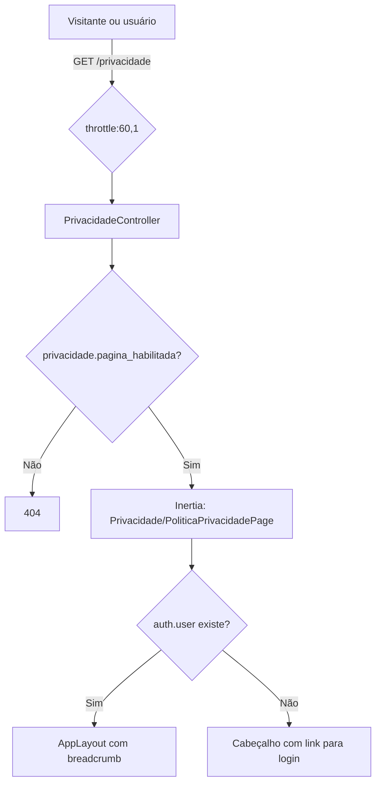

# Página Pública de Privacidade (T-17/T-18)

Página pública `GET /privacidade` com a Política de Privacidade do UniEspaços, os links que levam a ela e o rodapé comum dos e-mails.

> **Status: RASCUNHO.** O conteúdo aguarda aprovação do encarregado pelo tratamento de dados pessoais da UESB. O contato do encarregado é provisório: a Procuradoria Jurídica (Projur). A página exibe um aviso de rascunho até a aprovação.

## Visão Geral

- A rota é pública: não exige autenticação nem verificação de e-mail. Visitantes, usuários não verificados e usuários autenticados acessam a mesma URL.
- Usuário autenticado vê a página dentro do `AppLayout`, com breadcrumb. Visitante vê um cabeçalho próprio com link para o login.
- O conteúdo é renderizado no front (React). O back só envia a versão e a data de vigência como props.

## Componentes

| Arquivo | Papel |
|---------|-------|
| `config/privacidade.php` | Flag `pagina_habilitada`, `versao` e `data_versao` da política. |
| `routes/web.php` (linhas 39–42) | Rota `GET /privacidade`, nome `privacidade`, `throttle:60,1`, fora do grupo `auth`. |
| `app/Http/Controllers/PrivacidadeController.php` | Invocável. Responde 404 se a flag estiver desligada; senão renderiza a página com `versao` e `data_versao`. |
| `resources/js/presentation/pages/Privacidade/PoliticaPrivacidadePage.tsx` | Página. Escolhe o layout (autenticado ou visitante) e monta as seções. |
| `resources/js/i18n/locales/pt-BR.ts`, `en.ts`, `es.ts` | Textos no namespace `privacidade.*`. |
| `resources/js/presentation/molecules/PrivacyLink.tsx` | Molécula de link para a página. Aceita `newTab`, que abre em nova aba com texto oculto "nova aba" para leitores de tela. |
| `resources/js/presentation/molecules/RegisterStepPersonal.tsx` | Link ao lado da finalidade do telefone no cadastro (`newTab`). |
| `resources/js/presentation/templates/auth/AuthSplitLayout.tsx` | Link no rodapé das telas de autenticação. |
| `resources/js/presentation/templates/app/AppSidebarLayout.tsx` | Link no rodapé das telas autenticadas. |
| `resources/views/emails/layout.blade.php` | Link e contato no rodapé de todos os e-mails. Ver [notifications-and-channels.md](./notifications-and-channels.md#rodapé-comum-dos-e-mails-lgpd). |
| `.env.example` | Variável `PRIVACY_PAGE_ENABLED=true`. |

## Configuração

**Arquivo:** `config/privacidade.php`

| Chave | Origem | Padrão | Uso |
|-------|--------|--------|-----|
| `pagina_habilitada` | `PRIVACY_PAGE_ENABLED` | `true` | Liga ou desliga a rota. Desligada, `/privacidade` responde 404. |
| `versao` | fixo no arquivo | `'0.1-rascunho'` | Exibida no topo da página ("Versão: ..."). |
| `data_versao` | fixo no arquivo | `'2026-10-31'` | Exibida como "Atualizado em" (formatada `dd/MM/yyyy`). |

**Limitação da flag:** desligar `PRIVACY_PAGE_ENABLED` só troca a página por 404. Os links (`PrivacyLink` e rodapé do e-mail) continuam renderizados e levam a esse 404.

## Como Atualizar Versão e Data

`versao` e `data_versao` não vêm do `.env`. Mudá-las exige alterar `config/privacidade.php`, commitar e fazer deploy.

1. Editar `versao` e `data_versao` em `config/privacidade.php`.
2. Se o texto mudou, editar os valores das chaves `privacidade.*` nos três dicionários (`pt-BR.ts`, `en.ts`, `es.ts`), mantendo as mesmas chaves. Não há alteração em PHP.
3. Se o contato do encarregado mudou, atualizar **nos dois lugares**:
   - constantes `PROJUR_TELEFONE_EXIBICAO`, `PROJUR_TELEFONE_HREF` e `PROJUR_EMAIL` em `PoliticaPrivacidadePage.tsx`;
   - endereço `projur@uesb.edu.br` e texto de `emails/layout.blade.php`.
4. Rodar os testes listados abaixo.

Ao aprovar o texto definitivo, o aviso de rascunho deve sair: o bloco `<aside>` com `privacidade.rascunho_titulo` e `privacidade.rascunho_texto` em `PoliticaPrivacidadePage.tsx`, e as chaves correspondentes nos dicionários.

### Placeholders de instituição

Os textos usam `{{instituicao}}` e `{{sigla}}`. A página passa os valores pela constante `INSTITUICAO` (`Universidade Estadual do Sudoeste da Bahia (UESB)` e `UESB`). Assim, o nome da instituição não fica fixo no corpo dos dicionários.

## Estrutura do Conteúdo

O namespace `privacidade` do dicionário organiza as seções que a página renderiza, nesta ordem:

| Seção (chave) | Conteúdo atual do rascunho |
|---------------|----------------------------|
| `rascunho_titulo`, `rascunho_texto` | Aviso "Rascunho em revisão" (topo da página; usa `{{sigla}}`). |
| `controlador` | Controlador: a instituição (`{{instituicao}}`). |
| `encarregado` | Projur como canal provisório, telefone e e-mail, e nota sobre as caixas de e-mail dos campi. |
| `dados` | Lista de dados tratados: nome, e-mail, telefone, setor, foto (opcional), reservas e registros técnicos de segurança. |
| `finalidades` | Finalidades e bases legais: conta, reservas, notificações e segurança (arts. 7º, III, 23 e 46 da LGPD). |
| `telefone` | Uso do telefone como contato de emergência, visível só ao gestor do espaço da reserva. |
| `agenda` | Agenda pública: o nome de quem solicita a reserva aparece para os demais usuários. |
| `compartilhamento` | Operadores de hospedagem e e-mail; sem venda de dados. |
| `retencao` | Prazos em definição; ao excluir a conta, os dados pessoais são anonimizados. |
| `direitos` | Direitos do art. 18 da LGPD e como exercê-los (perfil ou canal do item 2). |
| `decisao` | Conflito entre reservas: a reserva que conflita com outra já deferida é indeferida automaticamente; pedido de revisão pelo gestor ou pelo canal do item 2. |
| `title`, `versao`, `atualizado_em`, `entrar`, `link_rodape`, `nova_aba` | Títulos, rótulos e links da página. |

## Testes

| Teste | Cobertura |
|-------|-----------|
| `tests/Feature/PaginaPrivacidadeTest.php` | Acesso de visitante, usuário autenticado e usuário não verificado (sem redirecionamento); 404 com a flag desligada; rota com nome `privacidade` e `throttle:60,1`. |
| `tests/Feature/EmailLayoutPrivacidadeTest.php` | Rodapé do layout de e-mail com link e contato jurídico. |
| `tests/Unit/LangJsonChavesTest.php` | Chaves do rodapé de e-mail presentes em `pt.json`, `pt_BR.json` e `es.json`. |
| `resources/js/presentation/pages/Privacidade/PoliticaPrivacidadePage.test.tsx` | Renderização da página (Jest). |
| `resources/js/presentation/molecules/RegisterStepPersonal.test.tsx` | Link no passo de telefone do cadastro (Jest). |
| `resources/js/presentation/templates/auth/AuthSplitLayout.test.tsx` | Link no rodapé de autenticação (Jest). |

## Pendências e Limitações

- **Conteúdo em rascunho.** Depende de aprovação do encarregado. Não tratar como versão definitiva.
- **Contato provisório.** Projur, até a designação formal do encarregado.
- **Contato duplicado.** O e-mail e o telefone do encarregado estão no TSX e no Blade. Mudanças de contato precisam ser feitas nos dois arquivos.
- **Flag não cobre os links.** Ver "Limitação da flag" em Configuração.
- **Versão e data em arquivo de código.** Cada revisão da política exige commit.

## Referências

- Configuração: `config/privacidade.php`
- Controller: `app/Http/Controllers/PrivacidadeController.php`
- Rota: `routes/web.php`
- Página: `resources/js/presentation/pages/Privacidade/PoliticaPrivacidadePage.tsx`
- Molécula: `resources/js/presentation/molecules/PrivacyLink.tsx`
- Dicionários: `resources/js/i18n/locales/` (namespace `privacidade`)
- Rodapé de e-mail: `resources/views/emails/layout.blade.php`
- Notificações e e-mails: [notifications-and-channels.md](./notifications-and-channels.md)
- Limites de taxa da rota: [authorization-policies.md](./authorization-policies.md#limites-de-taxa-throttling--t-29)
