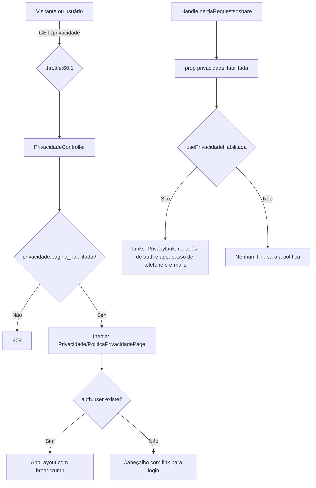

# Página Pública de Privacidade (T-17/T-18)

Página pública `GET /privacidade` com a Política de Privacidade do UniEspaços, os links que levam a ela e o rodapé comum dos e-mails.

> **Status: STANDBY (desligada por padrão).** A página não vai ao ar no release 1.5.0. Decisão do responsável, em 01/11/2026: os termos estão minimamente adequados, mas a UI/UX ficou desarmônica com o design do sistema. Com `PRIVACY_PAGE_ENABLED=false` (padrão), a rota responde 404 e nenhum link para a política é exibido.
>
> **Condição de retomada:** (1) levantamento de design antes de qualquer redesenho, a partir do que já existe no projeto: tokens Catppuccin do `@theme`, átomos, moléculas e templates em `resources/js/presentation`, primitivos shadcn em `resources/js/components/ui`, e os padrões de anatomia de página e de estado vazio entregues no #487; (2) redesenho a partir desse levantamento; (3) texto final aprovado (T-10, T-17, T-18 / F-01). O conteúdo atual segue como rascunho (versão `0.1-rascunho`) e depende de aprovação do encarregado. O item está no [backlog](../backlog.md).

## Visão Geral

- A rota é pública: não exige autenticação nem verificação de e-mail. Visitantes, usuários não verificados e usuários autenticados acessam a mesma URL.
- Usuário autenticado vê a página dentro do `AppLayout`, com breadcrumb. Visitante vê um cabeçalho próprio com link para o login.
- O conteúdo é renderizado no front (React). O back só envia a versão e a data de vigência como props.
- A flag `privacidade.pagina_habilitada` controla a página e também os links que apontam para ela (ver [Comportamento com a flag](#comportamento-com-a-flag)).

## Componentes

| Arquivo | Papel |
|---------|-------|
| `config/privacidade.php` | Flag `pagina_habilitada` (padrão `false`), `versao` e `data_versao` da política. |
| `routes/web.php` | Rota `GET /privacidade`, nome `privacidade`, `throttle:60,1`, fora do grupo `auth`. |
| `app/Http/Controllers/PrivacidadeController.php` | Invocável. Responde 404 se a flag estiver desligada; senão renderiza a página com `versao` e `data_versao`. |
| `app/Http/Middleware/HandleInertiaRequests.php` | Compartilha a prop `privacidadeHabilitada` (booleano, reflete `privacidade.pagina_habilitada`). |
| `resources/js/types/index.d.ts` | Tipo `SharedData.privacidadeHabilitada?: boolean`. |
| `resources/js/hooks/use-privacidade-habilitada.ts` | Hook `usePrivacidadeHabilitada()`. Retorna `true` só se a prop for `true`; ausente conta como desligada. |
| `resources/js/presentation/pages/Privacidade/PoliticaPrivacidadePage.tsx` | Página. Escolhe o layout (autenticado ou visitante) e monta as seções. |
| `resources/js/i18n/locales/pt-BR.ts`, `en.ts`, `es.ts` | Textos no namespace `privacidade.*`. |
| `resources/js/presentation/molecules/PrivacyLink.tsx` | Molécula de link para a página. Aceita `newTab`, que abre em nova aba com texto oculto "nova aba" para leitores de tela. Retorna `null` com a flag desligada. |
| `resources/js/presentation/molecules/RegisterStepPersonal.tsx` | Passo de telefone do cadastro. A finalidade do telefone aparece sempre; o link para a política só com a flag ligada (`newTab`). |
| `resources/js/presentation/templates/auth/AuthSplitLayout.tsx` | `<footer>` com o link no rodapé das telas de autenticação. Só renderiza com a flag ligada. |
| `resources/js/presentation/templates/app/AppSidebarLayout.tsx` | `<footer>` com o link no rodapé das telas autenticadas. Só renderiza com a flag ligada. |
| `resources/views/emails/layout.blade.php` | Rodapé de todos os e-mails. O parágrafo com o link da política só aparece com a flag ligada; o contato da Projur aparece sempre. Ver [notificacoes.md](../arquitetura/notificacoes.md#rodapé-comum-dos-e-mails-lgpd). |
| `.env.example` | Variável `PRIVACY_PAGE_ENABLED=false`. |

## Configuração

**Arquivo:** `config/privacidade.php`

| Chave | Origem | Padrão | Uso |
|-------|--------|--------|-----|
| `pagina_habilitada` | `PRIVACY_PAGE_ENABLED` | `false` | Liga ou desliga a rota e os links para ela. Desligada, `/privacidade` responde 404 e os links somem. |
| `versao` | fixo no arquivo | `'0.1-rascunho'` | Exibida no topo da página ("Versão: ..."). |
| `data_versao` | fixo no arquivo | `'2026-10-31'` | Exibida como "Atualizado em" (formatada `dd/MM/yyyy`). |

O padrão é `false` desde a decisão de standby. Se o servidor de staging ou produção definir `PRIVACY_PAGE_ENABLED=true` no `.env`, a página e os links voltam a aparecer. A release 1.5.0 confere isso (ver [backlog](../backlog.md)).

## Comportamento com a flag

Com a flag desligada (padrão), nenhum ponto do sistema aponta para a política:

| Ponto | Desligada | Ligada |
|-------|-----------|--------|
| `GET /privacidade` | 404 | Página da política |
| `PrivacyLink` | Não renderiza (`null`) | Link (com `newTab` quando aplicável) |
| Rodapé das telas de autenticação (`AuthSplitLayout`) | `<footer>` do link não renderiza | Link "Política de privacidade" |
| Rodapé das telas autenticadas (`AppSidebarLayout`) | `<footer>` do link não renderiza | Link "Política de privacidade" |
| Cadastro, passo "Dados Pessoais" | Finalidade do telefone aparece; link omitido | Finalidade e link em nova aba |
| Rodapé dos e-mails | Sem o parágrafo do link; contato da Projur aparece | Link da política e contato da Projur |

**Mecanismo.** `HandleInertiaRequests::share()` envia `privacidadeHabilitada` com o valor de `config('privacidade.pagina_habilitada')`. O hook `usePrivacidadeHabilitada()` lê a prop com `=== true`, então uma prop ausente vale como desligada. Os componentes de link usam só o hook; não decidem por conta própria. Nos e-mails, o Blade lê a config diretamente.

## Como Atualizar Versão e Data

`versao` e `data_versao` não vêm do `.env`. Mudá-las exige alterar `config/privacidade.php`, commitar e fazer deploy.

1. Editar `versao` e `data_versao` em `config/privacidade.php`.
2. Se o texto mudou, editar os valores das chaves `privacidade.*` nos três dicionários (`pt-BR.ts`, `en.ts`, `es.ts`), mantendo as mesmas chaves. Não há alteração em PHP.
3. Se o contato do encarregado mudou, atualizar **nos dois lugares**:
   - constantes `PROJUR_TELEFONE_EXIBICAO`, `PROJUR_TELEFONE_HREF` e `PROJUR_EMAIL` em `PoliticaPrivacidadePage.tsx`;
   - endereço `projur@uesb.edu.br` e texto de `emails/layout.blade.php`.
4. Rodar os testes listados abaixo.

Ao aprovar o texto definitivo, o aviso de rascunho deve sair: o bloco `<aside>` com `privacidade.rascunho_titulo` e `privacidade.rascunho_texto` em `PoliticaPrivacidadePage.tsx`, e as chaves correspondentes nos dicionários.

### Placeholders de instituição

Os textos usam `{{instituicao}}` e `{{sigla}}`. A página passa os valores pela constante `INSTITUICAO` (`Universidade Estadual do Sudoeste da Bahia (UESB)` e `UESB`). Assim, o nome da instituição não fica fixo no corpo dos dicionários.

## Estrutura do Conteúdo

O namespace `privacidade` do dicionário organiza as seções que a página renderiza, nesta ordem:

| Seção (chave) | Conteúdo atual do rascunho |
|---------------|----------------------------|
| `rascunho_titulo`, `rascunho_texto` | Aviso "Rascunho em revisão" (topo da página; usa `{{sigla}}`). |
| `controlador` | Controlador: a instituição (`{{instituicao}}`). |
| `encarregado` | Projur como canal provisório, telefone e e-mail, e nota sobre as caixas de e-mail dos campi. |
| `dados` | Lista de dados tratados: nome, e-mail, telefone, setor, foto (opcional), reservas e registros técnicos de segurança. |
| `finalidades` | Finalidades e bases legais: conta, reservas, notificações e segurança (arts. 7º, III, 23 e 46 da LGPD). |
| `telefone` | Uso do telefone como contato de emergência, visível só ao gestor do espaço da reserva. |
| `agenda` | Agenda pública: o nome de quem solicita a reserva aparece para os demais usuários. |
| `compartilhamento` | Operadores de hospedagem e e-mail; sem venda de dados. |
| `retencao` | Prazos em definição; ao excluir a conta, os dados pessoais são anonimizados. |
| `direitos` | Direitos do art. 18 da LGPD e como exercê-los (perfil ou canal do encarregado provisório). |
| `decisao` | Conflito entre reservas: a reserva que conflita com outra já deferida é indeferida automaticamente; pedido de revisão pelo gestor ou pelo canal do encarregado provisório. |
| `title`, `versao`, `atualizado_em`, `entrar`, `link_rodape`, `nova_aba` | Títulos, rótulos e links da página. |

## Testes

| Teste | Cobertura |
|-------|-----------|
| `tests/Feature/PaginaPrivacidadeTest.php` | Acesso de visitante, usuário autenticado e usuário não verificado (sem redirecionamento), com a flag ligada explicitamente; 404 com a flag desligada e com o padrão do arquivo de config (`false`); prop `privacidadeHabilitada` compartilhada com o valor da config; rota com nome `privacidade` e `throttle:60,1`. |
| `tests/Feature/EmailLayoutPrivacidadeTest.php` | Rodapé do layout de e-mail: com a flag ligada, link da política e contato jurídico; com a flag desligada, sem `/privacidade` e com o contato jurídico. |
| `tests/Unit/LangJsonChavesTest.php` | Chaves do rodapé de e-mail presentes em `pt.json`, `pt_BR.json` e `es.json`. |
| `resources/js/presentation/pages/Privacidade/PoliticaPrivacidadePage.test.tsx` | Renderização da página (Jest). |
| `resources/js/presentation/molecules/PrivacyLink.test.tsx` | Link com a flag ligada; `null` com a flag desligada ou ausente (Jest). |
| `resources/js/presentation/molecules/RegisterStepPersonal.test.tsx` | Passo de telefone: finalidade sempre; link só com a flag ligada (Jest). |
| `resources/js/presentation/templates/auth/AuthSplitLayout.test.tsx` | Rodapé de autenticação: link só com a flag ligada (Jest). |

## Pendências e Limitações

- **Página em standby.** Não entra no 1.5.0. A retomada segue a condição descrita no topo deste documento: levantamento de design, redesenho e texto final.
- **Conteúdo em rascunho.** Depende de aprovação do encarregado. Não tratar como versão definitiva.
- **Contato provisório.** Projur, até a designação formal do encarregado.
- **Contato duplicado.** O e-mail e o telefone do encarregado estão no TSX e no Blade. Mudanças de contato precisam ser feitas nos dois arquivos.
- **Versão e data em arquivo de código.** Cada revisão da política exige commit.
- **Configuração de ambiente.** Um `.env` de servidor com `PRIVACY_PAGE_ENABLED=true` reativa a página e os links; conferir antes de cada release.

## Referências

- Configuração: `config/privacidade.php`
- Controller: `app/Http/Controllers/PrivacidadeController.php`
- Compartilhamento da flag: `app/Http/Middleware/HandleInertiaRequests.php`
- Rota: `routes/web.php`
- Página: `resources/js/presentation/pages/Privacidade/PoliticaPrivacidadePage.tsx`
- Hook: `resources/js/hooks/use-privacidade-habilitada.ts`
- Molécula: `resources/js/presentation/molecules/PrivacyLink.tsx`
- Dicionários: `resources/js/i18n/locales/` (namespace `privacidade`)
- Rodapé de e-mail: `resources/views/emails/layout.blade.php`
- Notificações e e-mails: [notificacoes.md](../arquitetura/notificacoes.md)
- Limites de taxa da rota: [autorizacao.md](../regras-de-negocio/autorizacao.md#limites-de-taxa-throttling--t-29)
