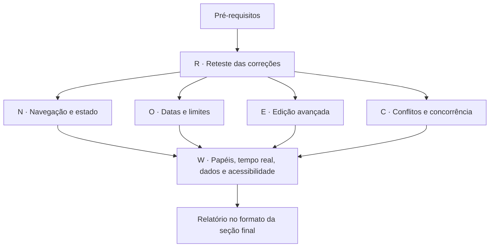

# Roteiro de QA — Reservas: reteste da rc.119 e fluxos não convencionais

Prompt pronto para acionar o QA (pessoa ou agente). Ele cobre duas coisas:

1. **Reteste (grupo R):** confirma em staging as correções feitas a partir do QA da rc.119 (E-01, E-02, P-04, C-02/C-03 e as observações 3, 4 e 7).
2. **Lacunas (grupos N a W):** fluxos que o roteiro anterior não cobriu, imaginando o que um usuário real faz fora do caminho feliz: clicar duas vezes, abrir duas abas, voltar no navegador, editar o que já foi avaliado, cruzar meia-noite e virada de ano, trocar de papel no meio do caminho.



---

## Prompt para o QA

> Copie a partir daqui.

````markdown
# QA — Reservas: reteste e fluxos não convencionais

Você é QA do UniEspaços (sistema de reserva de espaços da UESB). Execute os casos abaixo em **staging**, registre evidência de cada um e devolva o relatório no formato pedido no fim.

## Regras

- **Ambiente:** staging, com a versão que contém as correções do QA da rc.119 (confira a versão no rodapé ou com o responsável antes de começar; se não for a versão certa, pare e avise).
- **Contas (o responsável fornece):** `SOL-A` (solicitante comum), `SOL-B` (segundo solicitante comum), `GES` (gestor do espaço de teste), `INST` (institucional, se houver). Nunca use conta de pessoa real.
- **Espaço de teste:** um espaço **sem auto-aprovação** para solicitantes, com agenda nos três turnos. Para os casos de auto-aprovação, um espaço gerido por `GES`.
- **Não aprove, indefira nem cancele** reservas que não foram criadas por você neste roteiro. Os casos que pedem aprovação dizem isso explicitamente, e só valem para reservas do roteiro.
- **Título das reservas:** `QA2 <ID do caso>` (ex.: `QA2 R-03`), para o responsável limpar depois.
- **Evidência mínima por caso:** o que foi clicado, o que a revisão mostrou, a mensagem exibida (texto exato), e o resultado nos Detalhes (período, contagem por turno, número da reserva).
- **Divergência:** descreva o que aconteceu, o que era esperado e se é **determinística** (repita 2 vezes).
- **Segurança:** se encontrar algo que pareça falha de segurança, registre só o efeito observado e avise o responsável em privado. Não detalhe passo a passo no relatório.

## Convenção de datas

Escolha uma **terça-feira de referência** com pelo menos 5 dias de antecedência e sem feriado nas 6 semanas seguintes:

- T1 = terça de referência · T2 = T1 + 7 · T3 = T1 + 14 · T4 = T1 + 21 · T5 = T1 + 28
- Q1 = quinta da semana de T1 · Q2 = Q1 + 7 · Q3 = Q1 + 14
- "manhã / tarde / noite" = o 1º horário do turno (07:30, 13:10, 18:20).

Registre no topo do relatório as datas reais usadas.

---

## Grupo R — Reteste das correções (prioridade máxima)

| ID | Origem | Passos | Esperado |
|---|---|---|---|
| R-01 | E-01 | Crie `15 dias` com T1 manhã (3 horários: T1, T2, T3). Edite, escopo **Todas as ocorrências**, troque só T1 de manhã para tarde. | Revisão lista T1, T2 e T3 **tarde**. Detalhes: tarde 3, manhã 0. |
| R-02 | E-01 | Na mesma reserva, escopo **Todas as ocorrências**, **desmarque** a tarde de T1 e marque a noite de T1. | T1, T2 e T3 viram noite. Nenhum horário de tarde sobra. |
| R-03 | E-02 | Crie `15 dias` com T1 manhã. Edite, escopo **Apenas esta semana**, navegue até a semana de T2 e troque T2 de manhã para tarde. | Toast de sucesso. Detalhes: T1 manhã, **T2 tarde**, T3 manhã. Repita 2 vezes. |
| R-04 | E-02 | Escopo **Apenas esta semana**, na semana de T3, **desmarque** T3 (sem marcar outro). | T3 some. T1 e T2 ficam. O período nos Detalhes termina em T2. |
| R-05 | P-04 | Escolha `personalizado`, clique T1 manhã e Q1 tarde. Tente mudar a **data inicial**. | O campo de data inicial não é editável; mostra T1 (calculada). Data final continua editável. |
| R-06 | C-02 | Peça ao responsável (ou use `GES`) para aprovar uma reserva de apoio `QA2 APOIO` em T3 manhã. Com `SOL-A`, envie `15 dias` com T1 manhã. | Envio recusado. A mensagem **cita a data de T3 e o horário 07:30–08:20**, não diz "em análise" e fica visível por ~8 s. Nada é salvo. |
| R-07 | C-03 | Igual ao R-06, com `1 mês`. | Mesmo resultado, citando T3. |
| R-08 | Obs. 4 | Crie `15 dias` com T1 manhã. Na revisão, conte os horários listados. | Revisão: **3 horários** (T1, T2, T3), igual aos Detalhes. |
| R-09 | Obs. 4 | `1 mês` com T1 manhã + Q1 noite. | Revisão e Detalhes: 10 horários (5 + 5). |
| R-10 | Obs. 4 | `personalizado`, T1 tarde, T1 noite, Q1 tarde, Q1 noite, data final = T1 + 3 meses. | Revisão e Detalhes com a mesma contagem (confira a última quinta: se cair depois da data final, não entra). |
| R-11 | Obs. 3 | Abra a agenda em pt, en e es. | Cabeçalho do turno: "Manhã" / "Morning" / "Mañana" (com acento em pt e es). |
| R-12 | Obs. 7 | Em Minhas Reservas, abra os Detalhes de uma reserva de 3 semanas por um link com a semana de T2 na URL. | A grade do modal abre na semana de T2. Sem o parâmetro, abre na semana do primeiro horário. |
| R-13 | Obs. 2 | Abra o modal de solicitação em en e es. | Título do modal, títulos dos passos e botão "Avançar" traduzidos. ("Sair" e "Visualizar Notificações" ainda podem estar em pt: item já conhecido.) |

## Grupo N — Navegação e estado da tela

| ID | Passos | Esperado (ou pergunta a responder) |
|---|---|---|
| N-01 | Na revisão, clique **Enviar** duas vezes rápido (duplo clique). | Uma reserva só. O botão fica desabilitado enquanto envia. |
| N-02 | Abra a mesma agenda em **duas abas**, selecione o mesmo horário e envie nas duas. | Registre: duas reservas pendentes iguais? (Pendentes não bloqueiam, então provavelmente sim. Registre como observação.) |
| N-03 | Selecione horários, avance até o passo 3 e use o **Voltar do navegador**. | O modal fecha ou volta um passo, sem enviar nada e sem erro. Registre se a seleção sobrevive. |
| N-04 | Depois de enviar com sucesso, use o **Voltar do navegador** e tente enviar de novo. | Não cria reserva duplicada sem o usuário perceber. Registre o que acontece. |
| N-05 | Selecione 3 horários em semanas diferentes, **feche o modal** sem enviar e reabra. | Seleção preservada (ou descartada com aviso). Registre qual. |
| N-06 | Com horários selecionados, **recarregue a página** (F5). | Registre se a seleção se perde. Não deve haver erro. |
| N-07 | Abra o modal, deixe no passo 2 e, **em outra aba, saia da conta**. Volte e envie. | Mensagem clara de sessão expirada ou redirecionamento ao login. Nenhum erro técnico na tela. |
| N-08 | Troque o **idioma** com o modal aberto no passo 2. | Textos mudam de idioma; os dados digitados não se perdem (ou registre que se perdem). |
| N-09 | Selecione horários, navegue várias semanas para frente e para trás, depois envie. | Todas as seleções de todas as semanas aparecem na revisão e nos Detalhes. |
| N-10 | Selecione um horário e clique nele de novo 5 vezes; depois envie. | Estado final coerente com o número de cliques (par = desmarcado). |

## Grupo O — Datas e limites

| ID | Passos | Esperado (ou pergunta a responder) |
|---|---|---|
| O-01 | Hoje, depois das 10h, tente selecionar o horário das 07:30 **de hoje**. | Horário já passado não pode ser selecionado (ou é recusado no envio com mensagem clara). |
| O-02 | Entre 21h e 23h59 (horário da Bahia), tente reservar um horário de **amanhã cedo** e um de **hoje à noite** (se houver). | Ambos aceitos. Registre a hora exata do teste. (Verifica o fuso: o servidor usa UTC.) |
| O-03 | `15 dias` começando numa terça de **dezembro** que cruze a **virada do ano**. | Datas de janeiro corretas (ano seguinte), período certo nos Detalhes. |
| O-04 | `1 mês` começando em **31/03** (ou o dia 31 mais próximo de um mês seguido de mês de 30 dias). | Data final no último dia do mês seguinte (ex.: 30/04), sem pular para maio. |
| O-05 | `1 mês` começando em **29, 30 ou 31 de janeiro**. | Data final em 28/02 (ou 29/02 em ano bissexto). |
| O-06 | `personalizado` com data final **1 ano** à frente, 2 horários por semana. | Aceito ou recusado com mensagem clara. Registre a contagem salva e o tempo até aparecer em Minhas Reservas. |
| O-07 | Navegue a agenda para semanas **passadas** e tente selecionar. | Nada selecionável no passado. |
| O-08 | Selecione um horário de **sábado ou domingo** (se a agenda mostrar fim de semana). | Registre se é possível e se a recorrência repete no fim de semana. |
| O-09 | `personalizado`: depois de escolher a data final, **adicione** um horário numa data posterior a ela. | A data final se ajusta ou o envio é recusado com mensagem clara. A revisão e os Detalhes concordam. |
| O-10 | Selecione um horário **dentro de um feriado** (ex.: 25/12) com `unica`. | Registre: hoje o sistema não trata feriados (item conhecido). Só confirme. |

## Grupo E — Edição avançada

| ID | Passos | Esperado (ou pergunta a responder) |
|---|---|---|
| E-10 | Edite uma reserva `15 dias` trocando a recorrência para **Apenas os horários selecionados**. | Registre o que acontece com T2 e T3 (somem ou ficam?). Revisão e Detalhes devem concordar. |
| E-11 | Edite uma reserva `1 mês` trocando para `15 dias`. | Horários depois da nova data final somem. Contagem da revisão = Detalhes. |
| E-12 | Edite uma reserva `15 dias` trocando para `1 mês`. | Novos horários até a nova data final, sem duplicar os existentes. |
| E-13 | Peça ao `GES` para **aprovar só T1** de uma reserva `15 dias` sua (aprovação parcial). Depois edite T3 com **Apenas esta semana**. | T1 continua deferido. Registre se a edição é permitida e o que acontece com a situação de cada horário. |
| E-14 | Mesmo cenário do E-13, editando com **Todas as ocorrências** trocando manhã por tarde. | Registre: T1 (deferido) muda? Perde a aprovação? Fica um horário aprovado no turno antigo? |
| E-15 | Reserva com T1 **já passado** (crie uma com T1 = hoje, ou use uma antiga). Edite com **Todas as ocorrências** trocando o turno. | O horário passado não é alterado. Só os futuros mudam. |
| E-16 | **Apenas esta semana**: navegue até uma semana **fora do período** da reserva e marque um horário ali. | Registre: o horário é aceito (e o período cresce) ou recusado com mensagem clara. Não pode falhar em silêncio. |
| E-17 | **Apenas esta semana**: desmarque **todos** os horários da reserva inteira (todas as semanas visíveis). | Registre: aviso de "selecione ao menos um horário" ou comportamento claro. Nenhuma reserva sem horário. |
| E-18 | Edite com **Todas as ocorrências** para um turno em que **T2 já tem reserva aprovada** de outra pessoa. | Envio recusado, mensagem cita a data de T2 e o horário. Nada muda na reserva. |
| E-19 | Abra a edição da mesma reserva em **duas abas**, salve uma alteração diferente em cada. | A segunda não corrompe a reserva (sem horário duplicado). Registre o estado final. |
| E-20 | Enquanto `GES` está com a tela de avaliação aberta, `SOL-A` edita a reserva. `GES` então aprova. | Registre: o gestor aprova a versão nova ou a antiga? Recebe algum aviso? |
| E-21 | Tente editar uma reserva **cancelada**, **indeferida** e **totalmente deferida** (pelo botão e pelo endereço de edição digitado na barra). | Edição bloqueada com mensagem clara onde a regra não permite. Sem erro técnico. |
| E-22 | Edite só o **título** e a **descrição**, sem mexer em horários. | Horários e avaliações intactos. |

## Grupo C — Conflitos e concorrência

| ID | Passos | Esperado (ou pergunta a responder) |
|---|---|---|
| C-10 | `SOL-A` e `SOL-B` pedem o **mesmo horário vazio**. `GES` aprova a de `SOL-A`. | A de `SOL-B` é indeferida automaticamente (ou sinalizada em conflito) com justificativa. Registre o texto. |
| C-11 | `SOL-A` pede `15 dias` (3 horários). `SOL-B` pede só T2 no mesmo turno. `GES` aprova a de `SOL-B` primeiro. | Ao avaliar a de `SOL-A`, o gestor vê o conflito em T2. Registre o que a tela permite (aprovar parcial? só indeferir?). |
| C-12 | `SOL-A` e `SOL-B` enviam o mesmo horário vazio **ao mesmo tempo** (combine um "já"). `GES` tenta aprovar as duas. | Nunca ficam duas aprovadas no mesmo horário. |
| C-13 | Mesmo espaço, **agendas de turnos diferentes**: reserva aprovada na manhã de T1. Peça a tarde de T1. | Aceito, sem falso conflito. |
| C-14 | `SOL-A` tem reserva **aprovada** em T1 manhã e pede de novo T1 manhã. | Recusado com a mensagem de conflito (mesmo sendo dele). Registre. |
| C-15 | Reserva aprovada de `SOL-B` em T2 manhã é **cancelada** por ele. Em seguida `SOL-A` pede `15 dias` com T1 manhã. | Aceito (o horário cancelado não bloqueia mais). |

## Grupo W — Papéis, tempo real, dados e acessibilidade

| ID | Passos | Esperado (ou pergunta a responder) |
|---|---|---|
| W-01 | `GES` solicita num espaço **que não gere**. | Nasce **em análise** (sem auto-aprovação). |
| W-02 | `GES` solicita no espaço que gere, num horário com **pendente** de `SOL-A`. | Nasce deferida. Registre o que acontece com a pendente de `SOL-A` (indeferida automaticamente? notificada?). |
| W-03 | `GES` avalia uma reserva criada por ele mesmo em outro espaço (se tiver acesso). | Registre se é possível. |
| W-04 | Com `SOL-A` aberto em duas abas, envie uma reserva numa aba. | A lista de Minhas Reservas da outra aba atualiza sem recarregar (ou em poucos segundos). |
| W-05 | `GES` com a agenda aberta; `SOL-A` envia uma reserva. | `GES` recebe notificação em tempo real. O texto não mostra dado pessoal além do necessário. |
| W-06 | Force uma edição que falhe (ex.: E-18 depois que a validação passou, se conseguir reproduzir corrida) ou peça ao responsável. | Registre se o usuário fica sabendo da falha (toast, notificação) ou se só vê "Atualizando…". |
| W-07 | Título com **255** caracteres, depois **256**. Descrição com **2000**, depois **2001**. | 255 e 2000 aceitos; 256 e 2001 recusados com mensagem clara, no idioma ativo. |
| W-08 | Título e descrição com **emoji**, **acentos**, **quebras de linha** e trechos de **marcação HTML** (ex.: `<b>teste</b>`). | Tudo aparece como texto puro nos Detalhes, na avaliação, na notificação e no e-mail. |
| W-09 | Público estimado **0**, **negativo**, **decimal** e **muito grande** (ex.: 99999). | Recusa clara para valores inválidos. Registre os limites. |
| W-10 | Faça o fluxo inteiro (selecionar, avançar, enviar) **só pelo teclado** (Tab, Enter, Espaço). | Possível do início ao fim, com foco visível. |
| W-11 | Faça o fluxo inteiro num **celular** (ou janela de 375 px) e com **zoom de 200%**. | Grade utilizável, botões alcançáveis, nada cortado. |
| W-12 | Abra a reserva de outra pessoa digitando o endereço de Detalhes/edição com o número dela. | Acesso negado com página de erro amigável. Não mostra dados da outra pessoa. |
| W-13 | Em Minhas Reservas, filtre por um período que pega **só parte** de uma reserva recorrente. | A reserva aparece; os Detalhes mostram todos os horários. |

---

## Formato do relatório

Devolva um markdown com:

1. **Cabeçalho:** ambiente, versão testada, datas reais usadas (T1..T5, Q1..Q3), contas usadas (só os apelidos `SOL-A`, `SOL-B`, `GES`, `INST`).
2. **Resumo** com um gráfico `pie` (Passou / Divergência / Passou com observação / Não executado) e uma tabela por grupo.
3. **Divergências:** tabela `# | Caso | O que aconteceu | Esperado | Determinística?`.
4. **Observações** (não são falha do roteiro, mas valem atenção).
5. **Resultados por caso:** tabela `ID | Solicitado | Revisão | Detalhes (#reserva) | Div.`.
6. **Reservas criadas:** tabela `# | Título | Recorrência | Situação`, marcando as que foram aprovadas e por quê.
7. **Respostas às perguntas** dos casos que dizem "Registre" (um parágrafo curto por caso).
````

---

## Origem dos casos

| Grupo | De onde veio |
|---|---|
| R | Divergências e observações do QA da rc.119 corrigidas na branch `fix/qa-rc119-recorrencia`. |
| N | Comportamentos comuns de usuário fora do caminho feliz (duplo clique, abas, voltar, sessão). |
| O | Regras de data: `after_or_equal:today`, `addMonths` no cálculo de `1mes`, fuso de negócio (S36) e feriados (QA119-F1). |
| E | Escopos de edição (`single`/`recurring`), troca de recorrência e reserva parcialmente avaliada (GAP-06, GAP-09). |
| C | Conflitos só com horário deferido, auto-indeferimento na avaliação e concorrência (RR-H3). |
| W | Auto-aprovação do gestor, tempo real (S39), limites dos FormRequests, acessibilidade e autorização por reserva. |
