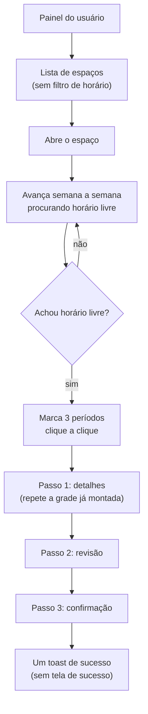
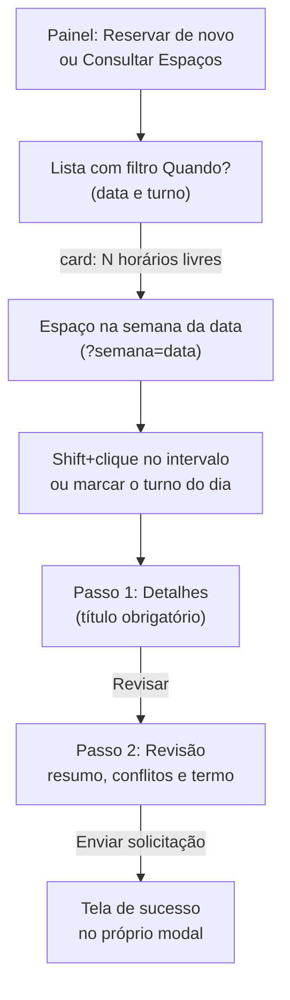
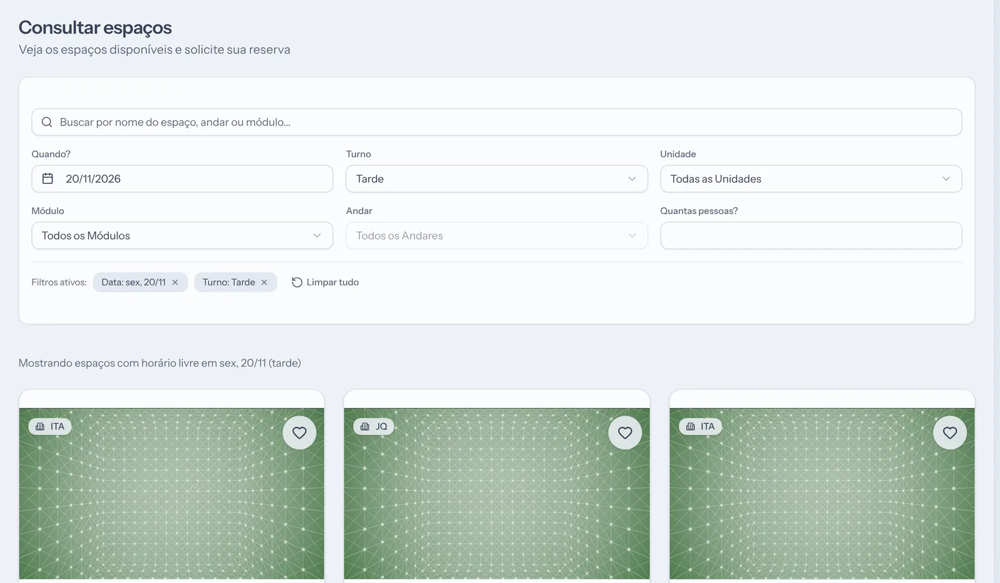
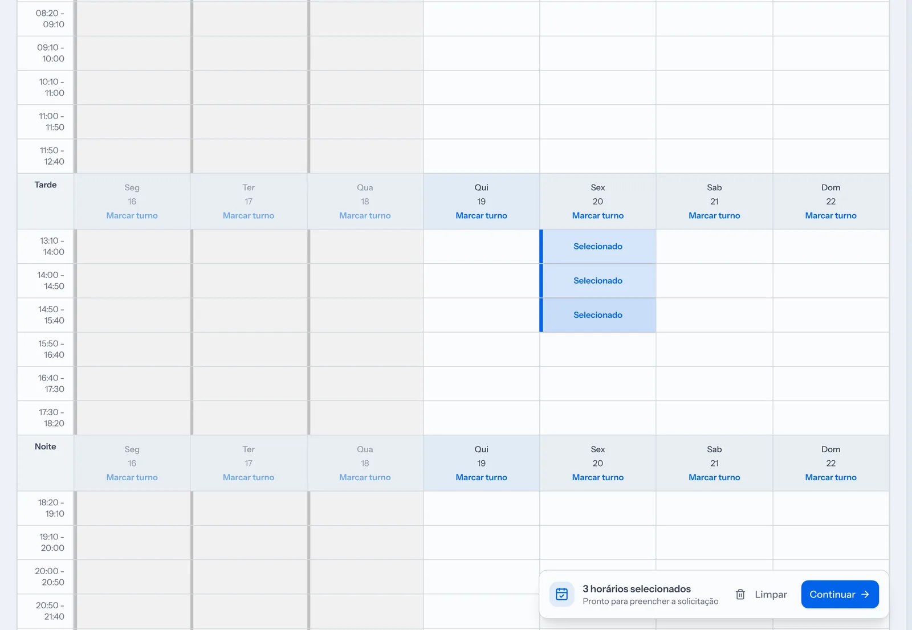
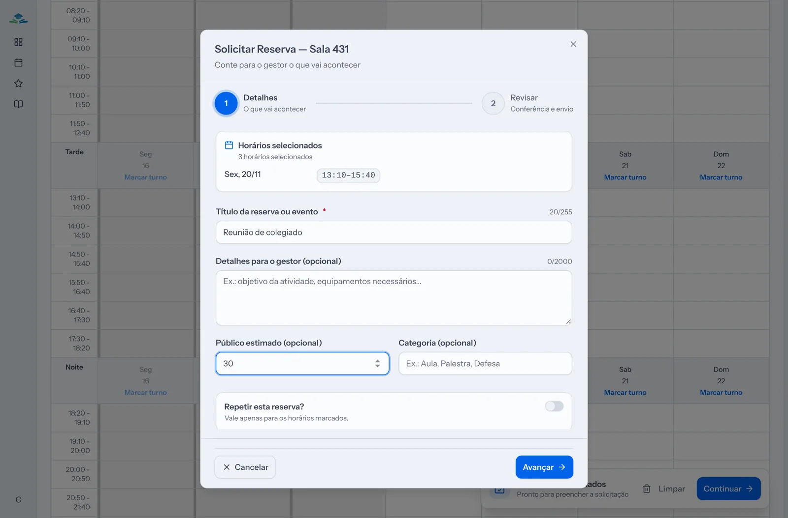
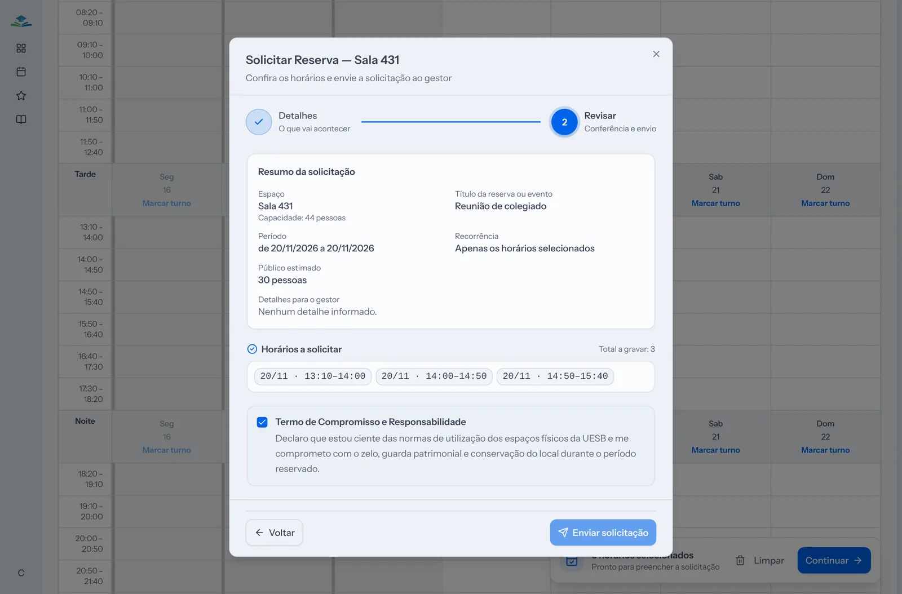
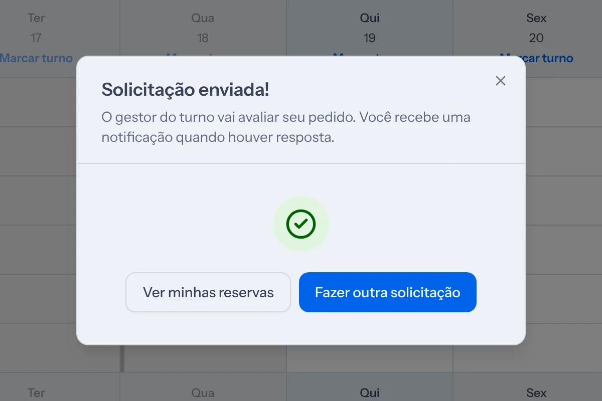
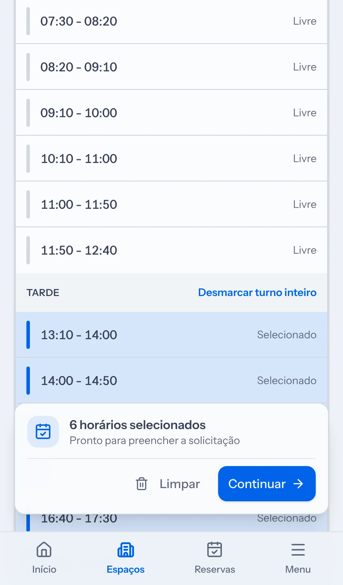
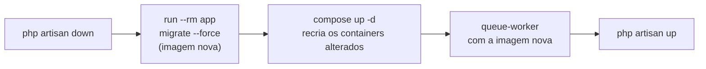

# Análise de UX: solicitação de espaço pelo usuário comum

> **Data:** 19/11/2026 · **Branch:** `feat/ux-solicitacao-usuario` · **Itens no backlog:** `UX-01` a `UX-23` ([backlog](../../backlog.md), Onda 7)
> **Método:** a análise de partida leu o código das telas (painel, lista de espaços, agenda do espaço e modal de solicitação). O estado "depois" foi conferido no código da branch e no navegador: a aplicação rodou localmente (banco com seed de desenvolvimento) e o fluxo completo foi percorrido com Playwright, no desktop e no mobile (ver a [seção 4.1](#41-como-ficou-telas)).

## 1. Objetivo e ator

- **Ator:** usuário comum, que solicita horário em um espaço sem ser gestor dele.
- **Objetivo:** reduzir o esforço para pedir um horário livre. A pessoa deve achar um espaço com vaga, marcar o horário com poucos cliques, enviar com clareza do que aconteceu e voltar para as próprias reservas.
- **Fora do escopo:** a avaliação pelo gestor e a visibilidade de solicitações pendentes de terceiros (item #107 do backlog).

## 2. Jornada antes

Antes da entrega, a lista não informava disponibilidade. Quem queria reservar precisava abrir cada espaço e percorrer as semanas à procura de um horário livre.

**Custo estimado por tentativa:** cerca de 12 a 14 cliques e 2 textos obrigatórios (título e justificativa). A contagem é da análise de partida, não de medição.

## 3. Achados

Os IDs seguem a ordem da análise. "O que foi feito" descreve a branch, não a `develop`.

| ID    | Gravidade | Achado                                                                                                                                    | O que foi feito                                                                                                                                                                           |
| ----- | --------- | ----------------------------------------------------------------------------------------------------------------------------------------- | ----------------------------------------------------------------------------------------------------------------------------------------------------------------------------------------- |
| UX-01 | 🔴        | Não havia busca por disponibilidade: a lista não dizia se o espaço tinha horário livre numa data.                                         | Filtro "Quando?" (data e turno) só na página do usuário comum, com chips e resumo. Card com selo "N horários livres" e link para a semana da data.                                        |
| UX-02 | 🔴        | Campos preenchidos no formulário não eram gravados pelo backend.                                                                          | Migration com `publico_estimado`, `categoria` e `termo_aceito_em`. Público e categoria aparecem ao gestor e ao solicitante.                                                               |
| UX-03 | 🔴        | A célula da agenda era um `div` com clique: não recebia foco nem era acionada pelo teclado.                                               | Célula virou `button` com `aria-label` descritivo, `aria-pressed` e foco visível. Célula reservada focável abre o detalhe por foco ou toque.                                              |
| UX-04 | 🟡        | O passo 1 (detalhes) repetia a grade que a pessoa tinha acabado de montar.                                                                | Modal em dois passos: Detalhes e Revisão. Antes eram três.                                                                                                                                |
| UX-05 | 🟡        | A justificativa era obrigatória na tela (até 1000 caracteres), mas opcional no backend (até 2000).                                        | Campo "Detalhes para o gestor (opcional)", até 2000 caracteres, alinhado à regra de [validação](../../regras-de-negocio/validacao.md).                                                    |
| UX-06 | 🟡        | O botão "Confirmar Reserva" prometia reserva garantida, e o sucesso aparecia só num toast.                                                | CTA "Enviar solicitação". Tela de sucesso no próprio modal, com "Ver minhas reservas" e "Fazer outra solicitação".                                                                        |
| UX-07 | 🟡        | A seleção era clique a clique: marcar três períodos exigia um clique por horário.                                                         | Shift+clique marca o intervalo no mesmo dia e turno (desktop). Botão marca ou desmarca o turno inteiro do dia (desktop no cabeçalho do dia; mobile na faixa do turno, com 44 px ou mais). |
| UX-08 | 🟡        | O hover tinha a mesma aparência da seleção, e a pessoa não distinguia o que estava marcado.                                               | Hover neutro. Estado "selecionado" em `primary` em todas as telas; o verde fica só para `deferida`.                                                                                       |
| UX-09 | 🟡        | O subtítulo do modal era o mesmo em todos os passos ("Selecione a data, turno e horários desejados") e pedia algo já feito no calendário. | Subtítulo próprio por passo: "Conte para o gestor o que vai acontecer" (Detalhes) e "Confira os horários e envie a solicitação ao gestor" (Revisar).                                      |
| UX-10 | 🟡        | O conflito era calculado, mas não aparecia na tela de solicitação.                                                                        | Conflito por slot, com checagem estática e em tempo real, no passo Revisão. Botão "Remover horários em conflito". Envio bloqueado enquanto houver conflito.                               |
| UX-11 | 🟢        | O painel tinha o atalho "Consultar Espaços" duplicado.                                                                                    | Atalho duplicado removido. Atalhos viraram links reais. Nova seção "Reservar de novo" com os espaços recentes.                                                                            |
| UX-12 | 🟢        | A capacidade era escolhida num `select`.                                                                                                  | Campo numérico "Quantas pessoas?", também na administração. O público estimado no modal avisa (sem bloquear) quando passa da capacidade.                                                  |
| UX-13 | 🟢        | Hierarquia: título duplicado, e o cabeçalho empurrava o calendário para baixo.                                                            | Título único, bloco recolhível e `GenericHeader` removido da página da agenda.                                                                                                            |
| UX-14 | 🟡        | Inconsistência: "selecionado" em verde e em azul, textos fixos fora do i18n e botões de tamanhos diferentes.                              | "Selecionado" em `primary`. Rótulos de estado via i18n (`agenda.slot.estado.*`). Navegação de semana com botões de 40 px. Tipografia base em `text-sm`.                                   |
| UX-15 | 🔴        | No tema escuro, o texto secundário tinha contraste de 3,53:1 sobre `--muted`, abaixo do mínimo de 4,5:1 (WCAG AA).                        | `--muted-foreground` foi de 0.73 para 0.81, com contraste de cerca de 4,7:1.                                                                                                              |
| UX-16 | 🟡        | O card da lista tinha elementos interativos aninhados.                                                                                    | Card sem controles aninhados. O acesso por teclado é pelo link "Consultar horários".                                                                                                      |
| UX-17 | 🟡        | Alvos de toque de 32 a 36 px no CTA.                                                                                                      | Botões principais do modal e da barra de resumo com 40 px (`h-10`); botão do turno no mobile com 44 px ou mais.                                                                           |

**O que já funcionava bem e foi mantido:** visão mobile por abas, com linhas de 52 px; barra de resumo da seleção; filtros com chips; atualização ao vivo da agenda; o "total a gravar" no passo de revisão; recorrência padrão `unica`.

## 4. Jornada depois

**Custo estimado:** cerca de 7 cliques, contra 12 a 14 antes. O título é o único texto obrigatório. O filtro "Quando?" fica só na página do usuário comum; a administração não o usa.

### 4.1 Como ficou (telas)

Capturas da verificação no navegador (Playwright, 19/11/2026, banco com seed de desenvolvimento: nomes e textos são fictícios). O envio foi conferido até o fim: o job da fila gravou a reserva `em_analise` com `termo_aceito_em` preenchido.

| Tela                                                                   | O que mostrar                                                                                                                                                                               |
| ---------------------------------------------------------------------- | ------------------------------------------------------------------------------------------------------------------------------------------------------------------------------------------- |
|  | **Lista de espaços (UX-01, UX-12):** filtro "Quando?" com data e turno, chips removíveis, resumo "Mostrando espaços com horário livre em sex, 20/11 (tarde)" e "Quantas pessoas?" numérico. |
|              | **Agenda (UX-03, UX-07, UX-08):** três períodos marcados com um clique e um Shift+clique, "Marcar turno" no cabeçalho de cada dia e "selecionado" em azul (`primary`).                      |
|                     | **Passo Detalhes (UX-04, UX-05, UX-09):** resumo dos horários com os períodos contíguos unidos, título como único campo obrigatório e "Repetir esta reserva?" desligado por padrão.         |
|                       | **Passo Revisar (UX-06, UX-10):** resumo primeiro, "Total a gravar", termo de responsabilidade e o CTA "Enviar solicitação".                                                                |
|                            | **Sucesso (UX-06):** "Solicitação enviada!", com "Ver minhas reservas" e "Fazer outra solicitação".                                                                                         |
|         | **Mobile (UX-07, UX-17):** "Marcar turno inteiro" na faixa do turno, linhas de 52 px e barra de resumo com CTA grande.                                                                      |

## 5. Validação das migrations

A migration `2026_11_19_120000_add_dados_da_solicitacao_to_reservas_table.php` adiciona três colunas nullable em `reservas`, sem default e sem índice. As guardas `hasColumn` a tornam repetível. A validação foi feita em seis rodadas, num banco de simulação no estado da `develop` (rc.120) com 200 mil reservas.

| Rodada | Verificação                                          | Resultado                                                                                                                                                           |
| ------ | ---------------------------------------------------- | ------------------------------------------------------------------------------------------------------------------------------------------------------------------- |
| 1      | `migrate --pretend`                                  | Só três `ALTER TABLE ... ADD COLUMN ... null`. Nenhuma coluna existente alterada. É a única migration pendente.                                                     |
| 2      | Aplicação em 200 mil linhas                          | 7,74 ms. A tabela não foi reescrita (mesmo filenode). Hash dos dados existentes idêntico antes e depois. Todas as linhas com NULL nas colunas novas.                |
| 3      | Rollback, reaplicação e estado parcial               | O rollback remove só as três colunas e preserva os dados. A reaplicação funciona. Com uma coluna já existente, as guardas evitam erro.                              |
| 4      | Concorrência com transação longa, simulando o worker | O `artisan down` do deploy não para a fila. A migration esperou cerca de 3 s e concluiu sem erro nem deadlock. Um INSERT no formato antigo, logo depois, funcionou. |
| 5      | Rollback de imagem                                   | A suíte inteira da `develop` (código antigo) passou em 803 de 803 testes sobre o schema já migrado.                                                                 |
| 6      | Paridade com a CI                                    | Banco novo do zero, `migrate --seed --force` com o código da branch: 32 migrations, sem pendência.                                                                  |

Jobs com payload antigo estão cobertos por teste, e os construtores dos jobs não mudaram. O deploy roda a migration num container efêmero da imagem nova, durante o modo de manutenção, e depois recria os containers alterados (`docker/production/scripts/deploy.sh`):

**Conferência pós-deploy:** o `queue-worker` precisa subir com a imagem nova. O `queue:work` não relê código (armadilha do [CLAUDE.md](../../../CLAUDE.md)). A conferência está na tabela de passos agendados do backlog.

## 6. Verificações finais

| Verificação                  | Resultado                                                         |
| ---------------------------- | ----------------------------------------------------------------- |
| `npx tsc --noEmit`           | Limpo                                                             |
| `npm run lint:check`         | Limpo, sem supressão nova (`eslint-suppressions.json` intacto)    |
| `npx jest`                   | 859 de 859 testes, 138 suítes                                     |
| `php artisan test` (backend) | 834 de 834 testes, 5440 asserções                                 |
| Pint                         | Limpo                                                             |
| PHPStan                      | Não rodou localmente (pacote ausente no ambiente). Fica para a CI |

## 7. Pendências

Os itens abertos ficam no [backlog](../../backlog.md), na Onda 7:

- `UX-01` a `UX-17`: os achados desta análise, entregues na branch.
- `UX-18` a `UX-23`: pendências novas, com prioridade e esforço no backlog.
- Itens existentes com avanço parcial: `I18N-6d`, `GAP-07` e `#462`. O `QA119-F5` segue aberto, com a menção ao passo atualizada, e a `S14c` recebeu o reforço da factory de gestor.
