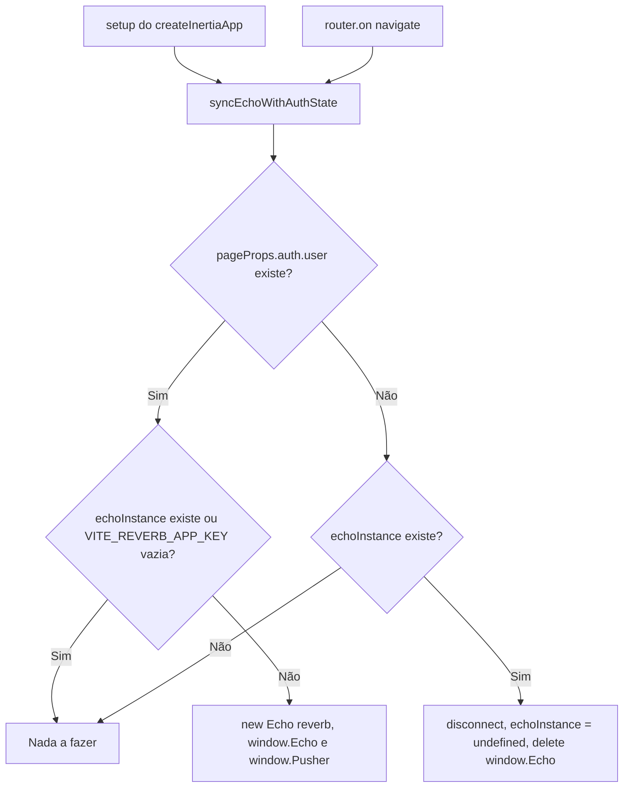

# Real-time WebSocket Channels (Reverb/Echo)

Este documento descreve a arquitetura de canais WebSocket implementada no UniEspaços usando Laravel Reverb como servidor e Laravel Echo como cliente JavaScript.

**Status:** ✅ GAP-11 Fase 4 — Implementado em v1.3.0-rc.45 (PR #338)

## Visão Geral

O sistema de real-time do UniEspaços implementa notificações e atualizações instantâneas através de WebSocket. A arquitetura separa preocupações em:

- **Backend:** Broadcasting de eventos (Laravel Event + Reverb)
- **Frontend:** Subscrição via Echo + canais customizados
- **Registro centralizado:** Channel registry com reference counting para lifecycle management

---

## Arquitetura de Canais

### Canais Implementados

#### 1. Canal Público: `reserva-channel`

**Localização:** Configurado em `app/Events/ReservaEvent.php`

**Responsabilidade:** Broadcasting de eventos de reserva para **todos os usuários conectados**.

**Uso:**
```php
// Backend: Em jobs que alteram reserva (criação, validação, avaliação)
ReservaEvent::dispatch('created', $reserva->id, $espacoId, $horariosCount);
ReservaEvent::dispatch('validated', $reserva->id, $espacoId, $horariosCount);
ReservaEvent::dispatch('evaluated', $reserva->id, $espacoId, $horariosCount);
```

**Evento Broadcast:**
```php
// Em ReservaEvent::broadcastOn()
return [
    'reserva-channel',  // Público
    "App.Models.Espaco.{$this->espacoId}"  // Privado (Fase 4)
];
```

**Payload Broadcast:**
```json
{
  "action": "created|validated|evaluated",
  "reservaId": 123,
  "espacoId": 5,
  "horariosCount": 3
}
```

**Frontend Listener:** Hook `useReservationLiveUpdates()`
- Subscreve ao canal público
- Escuta evento `.reserva-event`
- Dispara `CustomEvent('reserva:updated')` para propagação entre componentes

---

#### 2. Canal Privado: `App.Models.Espaco.{espacoId}`

**Localização:** Configurado em `routes/channels.php`

**Responsabilidade:** Broadcasting de atualizações específicas de espaço, com **autorização por espaço**.

**Autorização:**
```php
Broadcast::channel('App.Models.Espaco.{id}', function ($user, $id) {
    return $user->can('view', Espaco::findOrFail($id));
});
```

**Propósito:** Quando um gestor está visualizando um espaço específico (página `VisualizarEspacoPage`), recebe atualizações em tempo real apenas de reservas daquele espaço.

**Uso:**
- Mesmo evento de reserva é broadcast tanto em `reserva-channel` (público) quanto em `App.Models.Espaco.{id}` (privado)
- Usuário autorizado a visualizar espaço recebe atualização instantânea
- Usuário não autorizado não recebe

---

### Fluxo de um Evento de Reserva

**Exemplo: Criação de Reserva**

```
Request: POST /api/reservas
│
├─ StoreReservaRequest valida dados
│
├─ Job: ProcessarCriacaoReserva::dispatch($dados, $user)
│  └─ Enfileirado
│
└─ Response: 202 Accepted

[Fila processa job]

ProcessarCriacaoReserva::handle()
│
├─ DB Transaction
│  ├─ Cria Reserva (situacao='deferida' ou 'em_analise')
│  └─ Cria Horarios
│
├─ Notificações (try-catch)
│  ├─ $gestor->notify(NewReservationNotification)
│  └─ $solicitante->notify(ReservationCreatedNotification)
│
├─ Dispara ValidateReservationConflictsJob
│
└─ **Broadcast ReservaEvent**
   │
   ├─ Extrai espacoId = $reserva->horarios()->first()?->agenda->espaco_id
   ├─ Extrai horariosCount = $reserva->horarios()->count()
   │
   └─ ReservaEvent::dispatch('created', $reserva->id, $espacoId, $horariosCount)
      │
      └─ Reverb::broadcast([
           'reserva-channel',  # Todos veem
           'App.Models.Espaco.{espacoId}'  # Autorizados ao espaço veem
         ])

[Reverb processa]

Broadcast para Clients:
│
├─ Cliente 1: useReservationLiveUpdates (ativo)
│  └─ Recebe via 'reserva-channel'
│     └─ Dispara CustomEvent('reserva:updated', { reservaId: 123, action: 'created' })
│
└─ Cliente 2: useEspacoLiveUpdates (espaço_id=5, ativo)
   └─ Recebe via 'App.Models.Espaco.5' (se $espacoId === 5)
      └─ Dispara CustomEvent('reserva:updated', { reservaId: 123, action: 'created' })
```

---

## Ciclo de Vida da Conexão Echo

**Localização:** `resources/js/app.tsx` (função `syncEchoWithAuthState(pageProps)`)

A conexão Reverb **não é mais criada no carregamento do bundle**. Antes, `window.Echo` era instanciado incondicionalmente, inclusive em páginas públicas (`/login`, `/register`). Hoje o `window.Echo` existe somente enquanto há usuário autenticado, e a função `syncEchoWithAuthState` sincroniza a conexão com o estado de autenticação em dois pontos:

- **Carga inicial:** `setup()` do `createInertiaApp`, com `props.initialPage.props`.
- **Navegação:** `router.on('navigate', e => syncEchoWithAuthState(e.detail.page.props))`.



| Situação | Comportamento |
| --- | --- |
| Página pública (`/login`, `/register`), sem usuário | Nenhum Echo criado; nenhum socket Reverb aberto |
| Usuário autenticado, Echo ainda não criado | Cria `new Echo({ broadcaster: 'reverb', ... })` e atribui a `window.Echo` (e `window.Pusher`) |
| Usuário autenticado, `VITE_REVERB_APP_KEY` vazia | Echo não é criado |
| Usuário deixa de estar autenticado (logout) | `echoInstance.disconnect()`, instância zerada e `delete window.Echo` |

### Ressalva: evento `navigate` e visitas `replace`

O evento `navigate` do Inertia 2.3 dispara **depois do swap da página** e **somente em visitas que não são `replace`**. O Inertia trata como `replace` qualquer visita cuja URL final é igual à URL atual.

Como login (`/login` → `/dashboard`) e logout (→ `/login`) trocam de URL, o evento é disparado e a sincronização acontece. Uma mudança de estado de autenticação **que não troque de URL não é detectada**. Ao alterar esse fluxo, mantenha essa premissa em mente.

---

## Hooks React

### useReservationLiveUpdates()

**Localização:** `resources/js/hooks/useReservationLiveUpdates.ts`

**Responsabilidade:** Escutar canal público de reservas e disparar CustomEvent para toda a aplicação.

**Uso:**
```tsx
import { useReservationLiveUpdates } from '@/hooks/useReservationLiveUpdates';

export function ReservasPage() {
    useReservationLiveUpdates();  // Registra listener global

    useEffect(() => {
        document.addEventListener('reserva:updated', (event: CustomEvent) => {
            console.log('Reserva atualizada:', event.detail);
            // Refetch dados, invalida cache, etc.
        });
    }, []);
}
```

**Implementação:**
```tsx
export function useReservationLiveUpdates(): void {
    useEffect(() => {
        if (!window.Echo) return;

        const ACOES_QUE_ATUALIZAM = new Set(['created', 'validated', 'evaluated']);

        // Adquire canal público (reference-counted)
        const channel = acquirePublicChannel('reserva-channel');
        if (!channel) return;

        // Escuta evento com ponto obrigatório (padrão laravel-echo)
        channel.listen('.reserva-event', (event: ReservationEvent) => {
            if (ACOES_QUE_ATUALIZAM.has(event.action)) {
                document.dispatchEvent(
                    new CustomEvent('reserva:updated', {
                        detail: {
                            reservaId: event.reservaId,
                            action: event.action,
                        },
                    })
                );
            }
        });

        // Cleanup
        return () => {
            channel.stopListening('.reserva-event');
            releasePublicChannel('reserva-channel');
        };
    }, []);
}
```

**Ações que Atualizam:**
- `'created'` — Nova reserva criada
- `'validated'` — Conflitos validados
- `'evaluated'` — Reserva avaliada (aprovada/reprovada)

---

### useEspacoLiveUpdates(espacoId)

**Localização:** `resources/js/hooks/useEspacoLiveUpdates.ts` (Fase 4)

**Responsabilidade:** Escutar atualizações **específicas de um espaço**, com autorização via channel privado.

**Uso:**
```tsx
import { useEspacoLiveUpdates } from '@/hooks/useEspacoLiveUpdates';

export function VisualizarEspacoPage({ espaco }: Props) {
    // Subscreve a atualizações do espaço específico
    useEspacoLiveUpdates(espaco.id);

    useEffect(() => {
        // Reutiliza o mesmo listener global de reserva:updated
        document.addEventListener('reserva:updated', handleReservaAtualizada);
        return () => {
            document.removeEventListener('reserva:updated', handleReservaAtualizada);
        };
    }, []);
}
```

**Implementação:**
```tsx
export function useEspacoLiveUpdates(espacoId: number): void {
    useEffect(() => {
        if (typeof window === 'undefined' || !window.Echo) {
            return;
        }

        // Adquire canal privado com autorização automática
        const channel = acquirePrivateChannel(
            `App.Models.Espaco.${espacoId}`
        );
        if (!channel) return;

        // Escuta mesmo evento que a versão pública
        channel.listen('.reserva-event', (event: ReservationEvent) => {
            // Dispara o mesmo CustomEvent, reutilizando handlers
            document.dispatchEvent(
                new CustomEvent('reserva:updated', {
                    detail: {
                        reservaId: event.reservaId,
                        action: event.action,
                    },
                })
            );
        });

        // Cleanup
        return () => {
            channel.stopListening('.reserva-event');
            releasePrivateChannel(`App.Models.Espaco.${espacoId}`);
        };
    }, [espacoId]);  // Resubscreve se ID mudar
}
```

**Comportamento de Autorização:**
- Ao chamar `acquirePrivateChannel()`, Echo automaticamente autentica o canal
- Servidor verifica `$user->can('view', Espaco::findOrFail($id))`
- Se falhar, `channel` retorna `undefined` e hook descarta silenciosamente
- Se passar, usuário recebe atualizações instantâneas do espaço

---

## Channel Registry (Reference Counting)

**Localização:** `resources/js/lib/echo-channel-registry.ts`

**Responsabilidade:** Gerenciar lifecycle de subscrições com reference counting, evitando memory leaks.

### Problema Resolvido

Sem registry centralizado, múltiplas subscrições ao mesmo canal causam:
- **Memory leak:** Múltiplas cópias em memória do mesmo canal
- **Listeners duplicados:** Mesmo evento dispara múltiplas vezes
- **Cleanup incompleto:** `channel.leave()` chamado prematuramente enquanto outro hook ainda usa

### Solução: Reference Counting

Window.Echo é parametrizado como `Echo<'reverb'>` em `resources/js/types/global.d.ts`, permitindo tipagem segura dos canais sem `any`.

```tsx
// Estrutura interna (type-safe)
type EchoInstance = Window['Echo'];
export type EchoPublicChannel = ReturnType<EchoInstance['channel']>;

interface ChannelRef<T> {
    channel: T;
    refCount: number;
}

const publicChannels = new Map<string, ChannelRef<EchoPublicChannel>>();

export function acquirePublicChannel(name: string): EchoPublicChannel | undefined {
    const echo = window.Echo;
    if (!echo) return undefined;  // Ex.: página pública, sem Echo criado

    const existing = publicChannels.get(name);
    if (existing) {
        existing.refCount += 1;  // Incrementa referência
        return existing.channel;
    }

    const channel = echo.channel(name);  // Subscreve
    publicChannels.set(name, { channel, refCount: 1 });
    return channel;
}

export function releasePublicChannel(name: string): void {
    const existing = publicChannels.get(name);
    if (!existing) return;

    existing.refCount -= 1;
    if (existing.refCount <= 0) {
        window.Echo?.leave(name);  // Desinscreve só quando refCount chega a 0 e Echo existe
        publicChannels.delete(name);
    }
}
```

`acquirePrivateChannel` / `releasePrivateChannel` seguem o mesmo contrato, com `echo.private(name)` e `Map` próprio.

### Contrato de canal `undefined`

- `acquirePublicChannel` e `acquirePrivateChannel` retornam `undefined` quando `window.Echo` não existe (ex.: página pública, usuário não autenticado).
- `releasePublicChannel` e `releasePrivateChannel` só chamam `leave` se Echo existir; sem Echo, apenas removem a entrada do registry.
- **Consumidores precisam tolerar `undefined`:** sempre checar o retorno de `acquire*` antes de chamar `channel.listen(...)` ou `stopListening(...)`.

### Uso

```tsx
// Component A
const channel1 = acquirePublicChannel('reserva-channel');  // refCount=1
// ...
return () => releasePublicChannel('reserva-channel');  // refCount=0

// Component B (reutiliza)
const channel2 = acquirePublicChannel('reserva-channel');  // refCount=1
// channel1 === channel2 (mesmo objeto)
// ...
return () => releasePublicChannel('reserva-channel');  // refCount=0
```

---

## Validação de Dados

### HorariosMesmoEspaco (Nova em Fase 4)

**Localização:** `app/Rules/HorariosMesmoEspaco.php`

**Responsabilidade:** Garantir que uma reserva não abrange múltiplos espaços.

**Motivo:** Sem essa restrição, broadcasting para `App.Models.Espaco.{id}` seria ambíguo (qual ID?). Fase 4 impõe que toda Reserva aponta para UM espaço.

**Validação:**
```php
$espacoIds = [];
foreach ($value as $horario) {
    $espacoId = DB::table('agendas')
        ->where('id', $horario['agenda_id'])
        ->value('espaco_id');
    $espacoIds[] = $espacoId;
}

if (count(array_unique($espacoIds)) > 1) {
    // Falha: múltiplos espaços
}
```

**Mensagem:**
```
"Todos os horários solicitados devem estar no mesmo espaço."
```

---

## Fluxo de Integração

### Backend

1. **Job** (ex.: `ProcessarCriacaoReserva`) termina de alterar reserva
2. **Extrai espacoId:** `$reserva->horarios()->first()?->agenda->espaco_id`
3. **Extrai horariosCount:** `$reserva->horarios()->count()`
4. **Dispatch event:** `ReservaEvent::dispatch('created', $reserva->id, $espacoId, $horariosCount)`
5. **Reverb** transmite para canais:
   - Público: `reserva-channel`
   - Privado: `App.Models.Espaco.{espacoId}`

### Frontend

1. **Página** monta hooks:
   - `useReservationLiveUpdates()` — escuta globalmente
   - `useEspacoLiveUpdates(espaco.id)` — escuta espaço específico (se em detalhe)
2. **Registry** cuida de subscrição/desinscrição
3. **Listener** recebe evento
4. **Dispatch CustomEvent** — componentes interessados ouvem
5. **Refetch / invalidar cache** — lógica de negócio responde

---

## Configuração Ambiental

### Backend

**`.env`:**
```
BROADCAST_DRIVER=reverb

REVERB_SCHEME=http              # Interno Docker
REVERB_APP_ID=12345
REVERB_APP_KEY=...
REVERB_HOST=reverb              # Hostname do container Reverb
REVERB_PORT=8080
```

### Frontend

Variáveis lidas em `resources/js/app.tsx`: `VITE_REVERB_APP_KEY`, `VITE_REVERB_HOST`, `VITE_REVERB_PORT` e `VITE_REVERB_SCHEME` (`https` força TLS).

Se `VITE_REVERB_APP_KEY` estiver vazia, o Echo não é criado (ver [Ciclo de Vida da Conexão Echo](#ciclo-de-vida-da-conexão-echo)).

**`resources/js/app.tsx` (criação do Echo, dentro de `syncEchoWithAuthState`):**
```javascript
window.Pusher = Pusher;
echoInstance = new Echo({
    broadcaster: 'reverb',
    key: import.meta.env.VITE_REVERB_APP_KEY,
    wsHost: import.meta.env.VITE_REVERB_HOST,
    wssHost: import.meta.env.VITE_REVERB_HOST,
    wsPort: import.meta.env.VITE_REVERB_SCHEME === 'https' ? 443 : parseInt(import.meta.env.VITE_REVERB_PORT ?? '80', 10) || 80,
    wssPort: parseInt(import.meta.env.VITE_REVERB_PORT ?? '443', 10) || 443,
    forceTLS: import.meta.env.VITE_REVERB_SCHEME === 'https',
    enabledTransports: ['ws', 'wss'],
    disableStats: true,
});
window.Echo = echoInstance;
```

---

## Testing

### Unit: Registry

**Localização:** `resources/js/lib/echo-channel-registry.test.ts`

**Cobertura:**
- ✅ Reference counting (acquire → release)
- ✅ Múltiplas aquisições do mesmo canal
- ✅ Re-aquisição após full release
- ✅ Canais públicos vs privados independentes
- ✅ Reset para testes

### Integration: Hooks

**Localização:**
- `resources/js/hooks/useReservationLiveUpdates.test.ts` (Fase 3)
- `resources/js/hooks/useEspacoLiveUpdates.test.ts` (Fase 4)

**Cenários:**
- ✅ Subscrição ao mount
- ✅ Event dispatch → CustomEvent
- ✅ Cleanup ao unmount
- ✅ Re-subscrição em mudança de ID
- ✅ Sem erro se `window.Echo` indisponível

### E2E: Página

**Localização:** `resources/js/presentation/pages/Espacos/VisualizarEspacoPage.test.tsx`

**Cenários:**
- ✅ Hook é chamado com espaço correto
- ✅ CustomEvent é recebido
- ✅ Listener dispara
- ✅ Múltiplas instâncias reutilizam registry

---

## Troubleshooting

### "Channel returned is undefined"

**Causa:** `window.Echo` não existe. Isso é esperado em páginas públicas e para usuário não autenticado (o Echo só é criado com usuário autenticado e `VITE_REVERB_APP_KEY` preenchida), ou a conexão falhou

**Verificação:**
```bash
# Frontend console
console.log(window.Echo);  # Deve estar definido somente com usuário autenticado
```

**Solução:**

- Confirmar que o usuário está autenticado e que `VITE_REVERB_APP_KEY` está definida
- Confirmar que a visita de login/logout trocou de URL (visitas `replace` não disparam `navigate`, ver [Ciclo de Vida da Conexão Echo](#ciclo-de-vida-da-conexão-echo))
- Consumidores devem tratar `undefined` (ver [Contrato de canal `undefined`](#contrato-de-canal-undefined))

### "Element type is invalid; expected string but got undefined"

**Causa:** Vite servindo módulo vazio (~167 bytes) após reescrita

**Verificação:**
```bash
curl -s http://localhost:5173/path/to/module.tsx | wc -c
```

**Solução:**
```bash
touch resources/js/path/to/module.tsx
```

Força Vite a recompilar o arquivo.

### "channel.listen is not a function"

**Causa:** `acquirePrivateChannel()` retornou `undefined` (autorização falhou)

**Verificação:**
```bash
# Backend: confirmar que user pode visualizar espaço
dd($user->can('view', $espaco));
```

**Solução:**
- Garantir que usuário tem permissão `espacos.visualizar`
- Ou que pertence a setor cuja unidade gerencia o espaço

---

## Implicações e Armadilhas

### 1. CustomEvent é Global

**Comportamento:** Qualquer componente pode escutar `'reserva:updated'`

**Cuidado:** Não filtrar por contexto permite que componentes não relevantes respondam

**Padrão:**
```tsx
// ✅ Bom: filtrar por reserva_id no handler
channel.listen('.reserva-event', (event) => {
    if (event.reservaId === myReservaId) {
        // Processa apenas se relevante
    }
});

// ❌ Ruim: responder a qualquer reserva
channel.listen('.reserva-event', (event) => {
    refetchAll();  // Ineficiente
});
```

### 2. Autorização é Silenciosa

**Comportamento:** Se `$user->can('view', $espaco)` falha, `channel` é `undefined`

**Cuidado:** Código continua sem erro, apenas sem listener

**Padrão:**
```tsx
const channel = acquirePrivateChannel(`...`);
if (!channel) {
    // Falha silenciosa — usuário não autorizado
    // ou window.Echo indisponível
    return;
}
```

### 3. Reference Counting é Automático

**Comportamento:** Cleanup só acontece quando refCount === 0

**Cuidado:** Se múltiplos hooks usam o mesmo canal, um não pode desinscrever isoladamente

**Padrão:**
```tsx
// ✅ Certo: confiar no registry
useEffect(() => {
    const channel = acquirePublicChannel('x');
    return () => releasePublicChannel('x');  // Só remove se refCount === 0
}, []);
```

### 4. `queue:work` Não Relê Código

**Comportamento:** Worker carrega app na memória; mudanças em Job/Event/Notification não passam a valer

**Sintoma:** ReservaEvent nova não é disparada, ou dispatch com parâmetros antigos

**Solução:**
```bash
docker restart uniespacos-queue-worker-1
```

---

## Referências

- **Backend Event:** `app/Events/ReservaEvent.php`
- **Routes:** `routes/channels.php`
- **Jobs:** `app/Jobs/ProcessarCriacaoReserva.php`, `AvaliarReservaJob.php`, `UpdateReservaJob.php`, `ValidateReservationConflictsJob.php`
- **Hooks:** `resources/js/hooks/useReservationLiveUpdates.ts`, `useEspacoLiveUpdates.ts`
- **Ciclo de vida do Echo:** `resources/js/app.tsx`
- **Registry:** `resources/js/lib/echo-channel-registry.ts`
- **Validação:** `app/Rules/HorariosMesmoEspaco.php`
- **Página:** `resources/js/presentation/pages/Espacos/VisualizarEspacoPage.tsx`
- **Notificações:** `docs/notifications-and-channels.md`
- **Validações:** `docs/validation-rules.md`

---

## Histórico de Versão

- **v1.3.0-rc.45 (2026-08-23)** — GAP-11 Fase 4: Canais privados por espaço, hook `useEspacoLiveUpdates`, validação `HorariosMesmoEspaco`
- **v1.3.0-rc.44 (2026-08-22)** — GAP-11 Fase 3: Registry centralizado de canais com reference counting
- **v1.3.0-rc.42 e anteriores** — Fase 1/2: Broadcasting básico, notificações via Reverb
