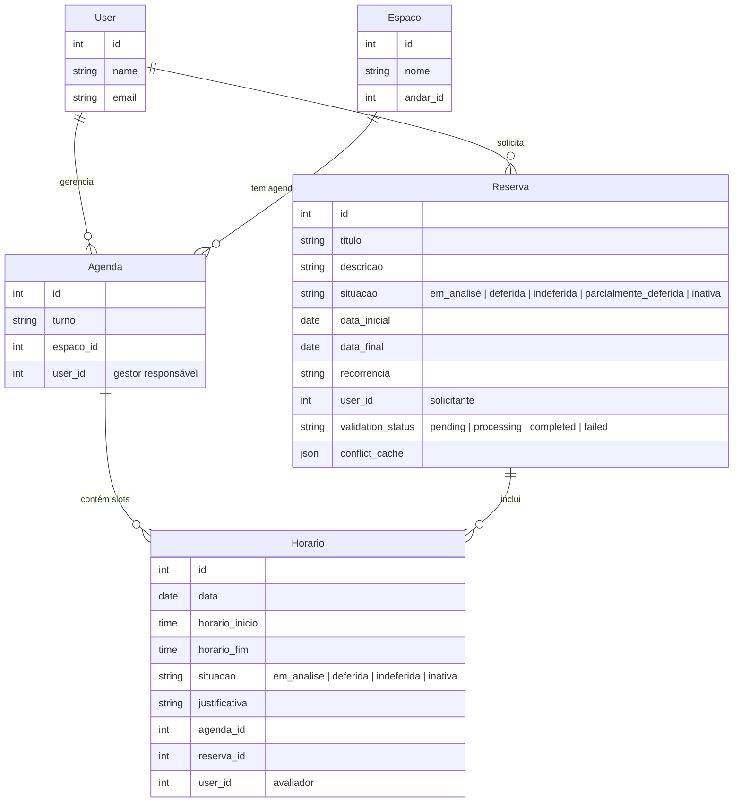
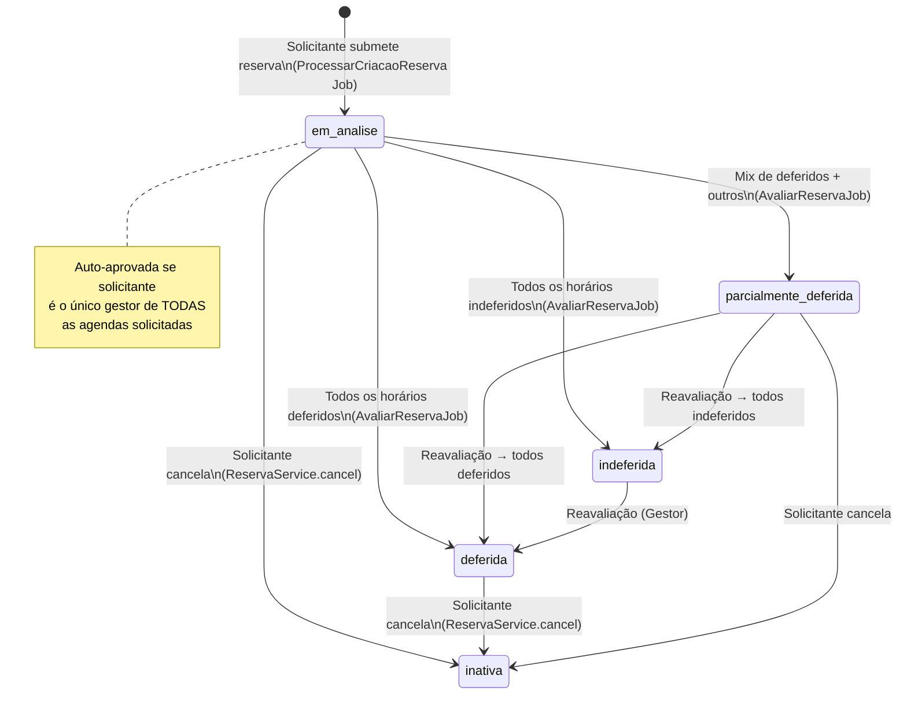
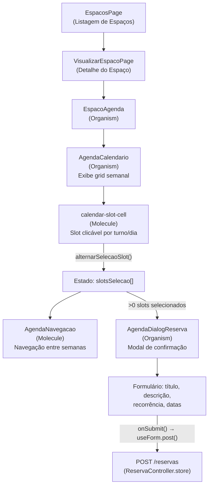
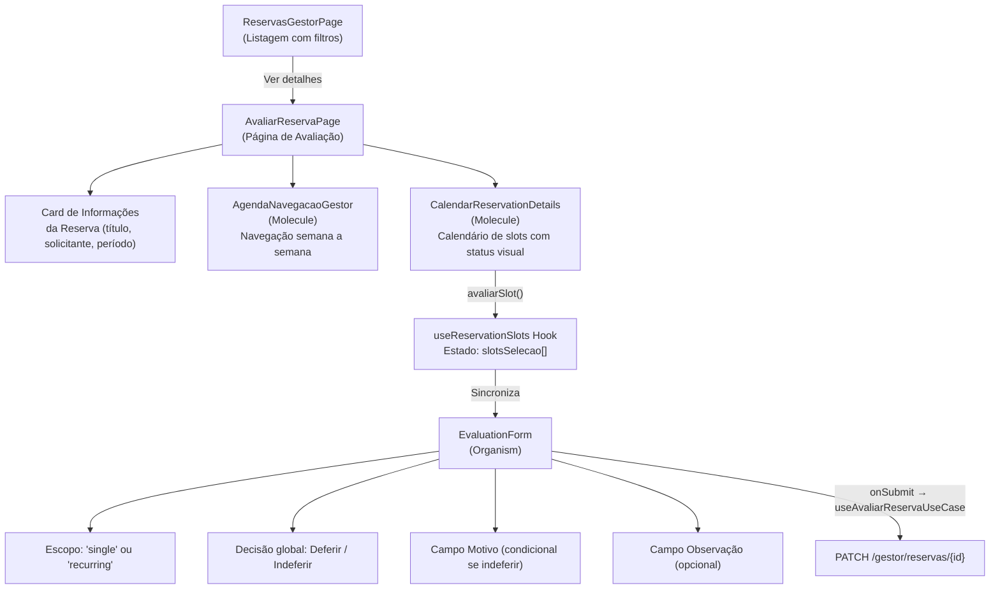
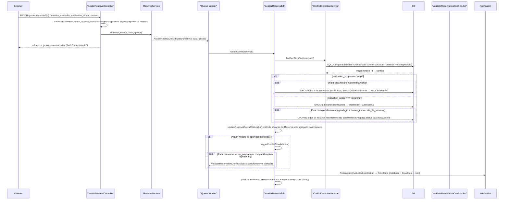
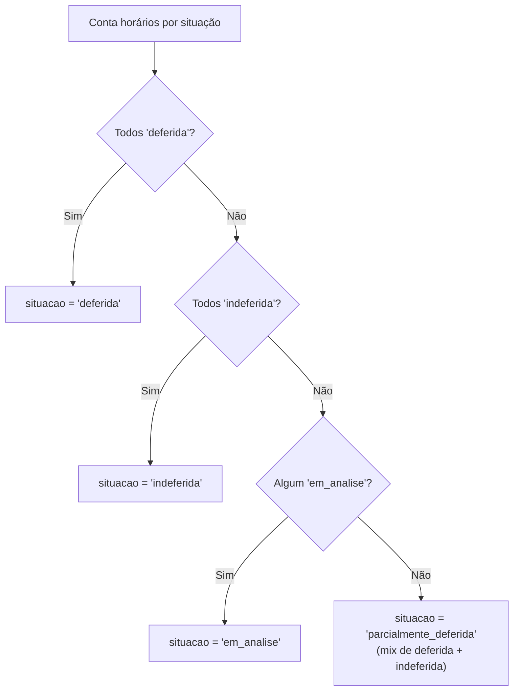
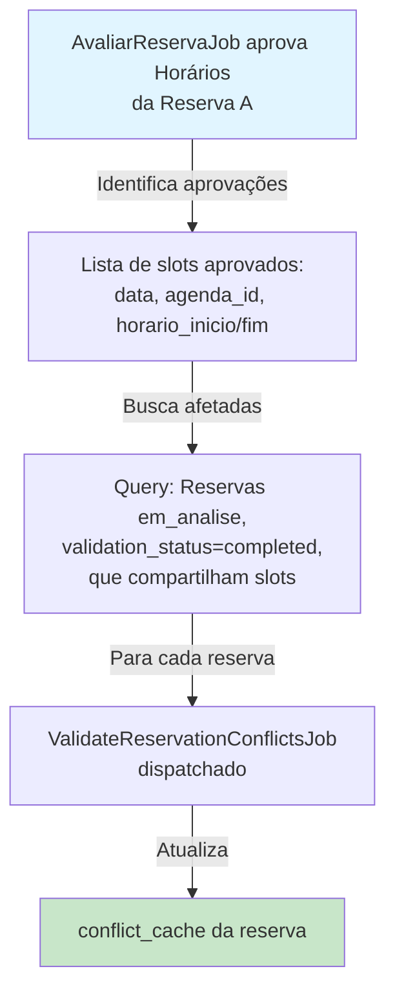
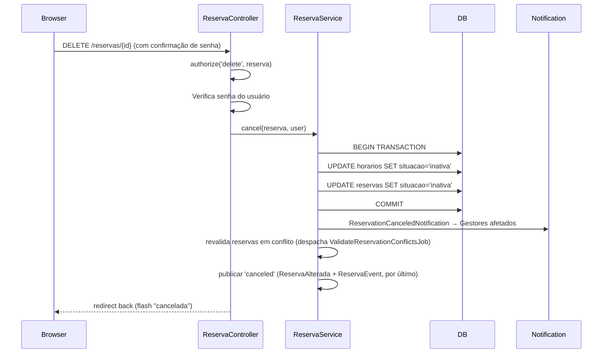

# Fluxo de reservas
> Última atualização: 2026-10-31 | Fluxo central de reservas: estados, criação, avaliação, cascata de revalidação, cancelamento e notificações

## Índice

1. [Visão Geral do Sistema](#visão-geral)
2. [Modelo de Dados Central](#modelo-de-dados)
3. [Estados da Reserva e Eixo de Arquivamento](#estados)
4. [Fluxo Completo de Criação](#fluxo-criação)
5. [Fluxo de Avaliação pelo Gestor](#fluxo-avaliação)
6. [Regra de Status Agregado](#status-agregado)
7. [Cascata de Revalidação](#cascata)
8. [Fluxo de Cancelamento](#cancelamento)
9. [Sistema de Notificações](#notificações)
10. [Eixos de Filtro](#eixos-de-filtro)
11. [Validação de Conflitos](#validação-conflitos)
12. [Componentes Frontend](#frontend-tree)
13. [Arquitetura Backend](#arquitetura)
14. [Pendências](#gaps)
15. [Referências de Código](#referências)

---

## 1. Visão Geral do Sistema {#visão-geral}

UniEspaços é uma aplicação web de reserva de espaços acadêmicos com arquitetura full-stack desacoplada:

| Camada | Tecnologia |
|--------|-----------|
| Backend | Laravel 12.x (PHP 8.4) |
| Frontend | React 19 + Inertia.js 2 + Tailwind CSS v4 + TypeScript 5.8 (SPA) |
| Database | PostgreSQL 16 |
| Real-time | Laravel Reverb (WebSockets via Broadcast) |
| Queue | Laravel Queue (background jobs) |
| Auth / RBAC | Spatie Laravel Permission |

O **fluxo central** da aplicação tem dois atores principais:
- **Solicitante** — qualquer usuário autenticado que solicita a reserva de um espaço.
- **Gestor** — usuário com permissão `secao.gestao-reservas` que avalia as solicitações de reserva.

---

## 2. Modelo de Dados Central {#modelo-de-dados}



**Relação chave:** Uma `Reserva` agrupa vários `Horario`s. Cada `Horario` pertence a uma `Agenda` (que é vinculada a um `Espaco` e tem um `User` gestor). O status final da `Reserva` é **derivado** do conjunto de status dos seus `Horario`s.

### Campos de Validação e Cache

| Campo | Tipo | Descrição |
|-------|------|-----------|
| `validation_status` | ENUM (pending\|processing\|completed\|failed) | Estado da validação assíncrona de conflitos. Começa em `pending`, passa por `processing` enquanto o job roda, termina em `completed` (sucesso) ou `failed`. |
| `conflict_cache` | JSON | Mapa de conflitos detectados pelo `ValidateReservationConflictsJob`. Armazena pares `horario_id → dados do conflito`. Atualizado pela cascata de revalidação. |

---

## 3. Estados da Reserva e Eixo de Arquivamento {#estados}

### 3.1 Separação: Situação vs Arquivo

**Situação** é o resultado da **avaliação** (quem aprova/rejeita a reserva):
- `em_analise`: aguardando avaliação do gestor
- `deferida`: aprovada
- `indeferida`: rejeitada
- `parcialmente_deferida`: mix de aprovados e rejeitados

**Arquivo** é um estado de **exclusão lógica** (arquivar = remover da visão padrão):
- `inativa`: reserva arquivada (cancelada ou excluída)

**Por quê separar?** Historicamente, `inativa` era tratada no mesmo field que os outros status, causando filtros contraditórios (ex.: "mostrar inativas E em_analise"). Agora:
- Use `situacao` para filtrar por **resultado de avaliação** (4 valores)
- Use `arquivo` (via `ModoArquivoEnum`) para filtrar por **visibilidade** (ATIVAS / ARQUIVADAS / TODAS)

Ver seção [10. Eixos de Filtro](#eixos-de-filtro) e [`arquivamento.md`](./arquivamento.md).

### 3.2 Diagrama de Transição de Estados



### 3.3 Regra de Auto-Aprovação

Se o solicitante for o único gestor de todas as agendas da reserva, a reserva e seus horários nascem `deferida`; se ele gerencia apenas algumas, a reserva nasce `parcialmente_deferida`. Regra completa e casos de borda em [`auto-aprovacao.md`](./auto-aprovacao.md).

---

## 4. Fluxo Completo de Criação de Reserva {#fluxo-criação}

### 4.1 Frontend — Seleção de Slots



### 4.2 Backend — Processamento Assíncrono

```mermaid
sequenceDiagram
    participant Browser
    participant ReservaController
    participant ReservaService
    participant Queue as "Queue Worker"
    participant ProcessarCriacaoReserva as "ProcessarCriacaoReserva Job"
    participant DB as "PostgreSQL"
    participant ValidateJob as "ValidateReservationConflictsJob"
    participant Notification

    Browser->>ReservaController: POST /reservas (dados validados)
    ReservaController->>ReservaService: create(data, user)
    ReservaService->>Queue: ProcessarCriacaoReserva::dispatch(data, user)
    ReservaController-->>Browser: redirect → espacos.index (flash "processando")

    Queue->>ProcessarCriacaoReserva: handle()
    ProcessarCriacaoReserva->>DB: BEGIN TRANSACTION
    ProcessarCriacaoReserva->>DB: INSERT INTO reservas (situacao='em_analise', validation_status='pending')
    ProcessarCriacaoReserva->>DB: SELECT horarios ... WHERE agenda_id IN (...) AND data BETWEEN ... FOR UPDATE (lock pessimista, agenda_id ordenado)
    ProcessarCriacaoReserva->>DB: Revalida conflito sob lock (mesma janela de agenda_id/data, situacao='deferida', overlap) — se detectar, ROLLBACK + throw
    loop Para cada horario_solicitado com recorrência semanal
        ProcessarCriacaoReserva->>DB: INSERT INTO horarios (situacao='em_analise' ou 'deferida' se auto-aprovação)
    end
    ProcessarCriacaoReserva->>DB: Auto-aprovação? Atualiza situacao='deferida' (se único gestor de TODAS)
    ProcessarCriacaoReserva->>DB: COMMIT

    ProcessarCriacaoReserva->>Notification: NewReservationNotification → Gestores (se não auto-aprovada)
    ProcessarCriacaoReserva->>Queue: ValidateReservationConflictsJob::dispatch(reserva)
    ProcessarCriacaoReserva->>Notification: ReservationCreatedNotification → Solicitante (suprime mail em auto-aprovação)
    ProcessarCriacaoReserva->>ProcessarCriacaoReserva: publicar 'created' (ReservaAlterada + ReservaEvent, por último)

    Queue->>ValidateJob: handle()
    ValidateJob->>DB: UPDATE reservas SET validation_status='processing'
    ValidateJob->>DB: SQL JOIN horarios para detectar conflitos (mesma agenda, data, sobreposição de horário)
    ValidateJob->>DB: UPDATE reservas SET conflict_cache=JSON, validation_status='completed'
    ValidateJob->>ValidateJob: publicar 'validated' (só ReservaEvent; falha não grava 'failed')
```

### 4.2.1 Defesa Contra Race Condition: Lock Pessimista e Revalidação

Há uma janela de tempo entre a validação síncrona de conflitos (na requisição HTTP, que apenas bloqueia slots já aprovados) e a inserção real dos novos horários (que ocorre quando o `ProcessarCriacaoReserva` job roda). Duas requisições concorrentes poderiam ambas passar na validação e ambas inserirem horários sobrepostos.

Para cobrir essa brecha, o job implementa uma defesa em duas etapas:

1. **Lock Pessimista (`lockForUpdate`):** Logo após criar a `Reserva`, antes de montar as linhas de horário, o job adquire um lock exclusivo sobre todos os horários existentes cuja `agenda_id` esteja entre as agendas afetadas pela nova reserva E cuja `data` esteja dentro do intervalo `data_inicial` até `data_final` da reserva. Os `agenda_id` são ordenados de forma determinística (`->sort()`) antes do lock para evitar deadlock entre transações concorrentes que poderiam acumular locks em ordens distintas.

2. **Revalidação de Conflito Sob Lock:** Depois que a expansão monta as linhas de horário a inserir, o job revalida cada linha nova contra horários já existentes e aprovados. Especificamente, para cada linha, verifica se existe um horário com mesma `agenda_id`, mesma `data`, `situacao = 'deferida'`, e cujo intervalo de horário se sobrepõe (`horario_inicio < novo.horario_fim AND horario_fim > novo.horario_inicio`). Se encontrar, lança uma `Exception` com mensagem descritiva, causando rollback automático da transação (desfeito inclusive o `Reserva::create` daquela tentativa). A exceção propaga para o `catch (Exception $e)` que envolve o `handle()`, é logada com `Log::error()`, e `$this->fail($e)` ativa o método `failed()` do job, que dispara `ReservationFailedNotification` ao solicitante.

A mesma estratégia de lock e revalidação foi aplicada em `UpdateReservaJob.php` em ambos os escopos (`edit_scope === 'recurring'` e `edit_scope === 'single'`):
- **Escopo `recurring`:** Lock adquirido sobre os horários das agendas afetadas dentro do intervalo `data_inicial`–`data_final`, posicionado antes da leitura de avaliações já feitas (`$avaliacoes`). A revalidação ocorre após a expansão montar as linhas, antes da inserção final. A verificação exclui horários da própria reserva sendo editada (`where('reserva_id', '!=', $this->reserva->id)`) para evitar falso conflito com horários antigos que já foram deletados.
- **Escopo `single`:** Lock adquirido sobre os horários das agendas afetadas na semana sendo editada (entre `startOfWeek()` e `endOfWeek()`). A revalidação ocorre para cada novo horário a inserir, imediatamente antes do `create()`. Da mesma forma, exclui horários da própria reserva da verificação de conflito.

### 4.3 Pipeline de Validação de Conflitos

O field `validation_status` acompanha o progresso do `ValidateReservationConflictsJob`:

| Status | Significado | Transição automática |
|--------|-------------|-----|
| `pending` | Job não iniciado ainda | → `processing` quando job inicia |
| `processing` | Job rodando, detectando conflitos | → `completed` ou `failed` |
| `completed` | Validação terminada com sucesso; `conflict_cache` está atualizado | Permanece até próxima revalidação |
| `failed` | Job falhou após retries; cache pode estar desatualizado | Manual (não há retry automático) |

**Nota:** Durante `pending` ou `processing`, a `AvaliarReservaPage` (gestor) exibe um spinner e bloqueia avaliação, pois não há conflitos verificados ainda.

### 4.4 Efeitos Depois do Commit {#efeitos-pos-commit}

Os efeitos externos de uma alteração de reserva só rodam depois que a transação foi commitada, nesta ordem:

| Ordem | Efeito | Se falhar |
|-------|--------|-----------|
| 1 | Validação de conflitos (`ValidateReservationConflictsJob`, na criação, edição e cascata de avaliação) | `validation_status = 'failed'` (após retries) |
| 2 | Notificações (`notify()` em try-catch, uma por destinatário) | `Log::warning`; o fluxo segue |
| 3 | Invalidação do cache de relatórios (`ReservaAlterada`, listener na fila) | Só para `created`, `updated`, `evaluated` e `canceled`. `validated` não invalida |
| 4 | Tempo real (`ReservaEvent` via `ReservaBroadcaster::publicar()`) | `Log::warning`; não altera a situação da reserva, o `validation_status` nem as notificações |

O tempo real é sempre o último passo. A exceção de status é `validated`: depois de gravar `completed`, falha de broadcast não regrava `failed`. O cancelamento segue a mesma regra, com a revalidação de reservas em conflito antes da publicação (ver [seção 8](#cancelamento)).

---

## 5. Fluxo de Avaliação pelo Gestor {#fluxo-avaliação}

### 5.1 Frontend — Tela de Avaliação



> **Nota importante:** O `AvaliarReservaPage` detecta `validation_status === 'processing'` ou `'pending'` e exibe um loading spinner em vez do formulário, evitando avaliação antes da validação de conflitos terminar.

### 5.2 Backend — Processamento da Avaliação



---

## 6. Regra de Status Agregado da Reserva {#status-agregado}

A situação final da `Reserva` é calculada em `AvaliarReservaJob::updateReservaOverallStatus()`:



### 6.1 Exibição para o Gestor

Na lista de reservas do gestor (`ReservasGestorPage`), o status é exibido com clareza sobre o que o gestor já fez. A situação é **recalculada dinamicamente no frontend** a partir dos horários individuais:

| Status | Exibição | Significado | Cálculo |
|--------|----------|-------------|---------|
| `deferida` | 🟢 Deferida | Gestor aprovou todos os horários | Todos os horários têm `situacao = 'deferida'` |
| `indeferida` | 🔴 Indeferida | Gestor recusou todos os horários | Todos os horários têm `situacao = 'indeferida'` |
| `em_analise` | 🟡 Em análise | Gestor ainda não avaliou algum horário ou nenhum foi avaliado | Algum horário tem `situacao = 'em_analise'` (prioridade máxima) |
| `parcialmente_deferida` | 🟠 Parcialmente Deferida | Gestor aprovou alguns horários e recusou outros | Há mix de `'deferida'` + `'indeferida'` (sem `'em_analise'`) |
| `inativa` | ⚫ Inativa | Reserva foi cancelada (arquivada) | Reserva cancelada pelo solicitante |

**Detalhe técnico:** O recálculo acontece em `calculateGestorStatus()` no frontend (`reserva-helpers.ts`). O repositório backend retorna **todos os horários** de cada reserva (sem limite), permitindo que o frontend analise cada um individualmente e derive a situação correta.

**Exemplo:** Uma reserva com 3 horários:
- Horário 1 (segunda 14h): ✅ deferida
- Horário 2 (quarta 14h): ❌ indeferida  
- Horário 3 (sexta 14h): ✅ deferida

→ Status exibido na listagem: **🟠 Parcialmente Deferida** (pois tem mix de aprovados + recusados)

---

## 7. Cascata de Revalidação de Conflitos {#cascata}

Quando o gestor aprova horários (`deferida`), o sistema automaticamente revalida outras reservas que disputam os mesmos slots. Isso evita que o cache de conflitos de outras reservas fique obsoleto.

### 7.1 Mecanismo

1. **Identificação de aprovações:** AvaliarReservaJob detecta quais horários foram aprovados (status `deferida`) nesta avaliação.

2. **Busca de afetadas:** Procura outras reservas que:
   - Estão em `situacao = 'em_analise'` (pendentes de avaliação)
   - Têm `validation_status = 'completed'` (já validadas)
   - Compartilham pelo menos um slot (`data`, `agenda_id`) com os horários recém-aprovados

3. **Revalidação:** Para cada reserva afetada, dispara `ValidateReservationConflictsJob` para:
   - Re-detectar conflitos contra os novos horários aprovados
   - Atualizar `conflict_cache` com conflitos atualizados

### 7.2 Diagrama



### 7.3 Exemplo Prático

- **Reserva A:** Solicitante pede segundo-feira 14h na Agenda X. Fica em análise.
- **Reserva B:** Outro solicitante pede segunda-feira 14h na mesma Agenda X. Fica em análise, sem conflitos iniciais (pois A ainda não foi aprovada).
- **Gestor aprova A:** `ValidateReservationConflictsJob` roda e marca os horários de A como `deferida`.
- **Cascata:** AvaliarReservaJob detecta que B compartilha a mesma Agenda+Data+Hora, dispara novo `ValidateReservationConflictsJob` para B.
- **B re-validado:** O novo job detecta conflito de B com A agora, atualiza `conflict_cache` de B.

> **Objetivo:** Garantir que o gestor sempre veja o estado atual de conflitos ao avaliar uma reserva, mesmo que outra tenha sido aprovada após a submissão.

---

## 8. Fluxo de Cancelamento {#cancelamento}



> **Nota:** O cancelamento é **síncrono** (não usa job/queue), diferente da criação e avaliação. Os efeitos depois do commit (avisos, revalidação e publicação) seguem a ordem da [seção 4.4](#efeitos-pos-commit).

---

## 9. Sistema de Notificações {#notificações}

Todas as notificações relacionadas a reserva estendem `BaseNotification` que implementa `ShouldQueue`:

### 9.1 Canais de Entrega

| Canal | Tecnologia | Timing | Quando suprimido |
|-------|-----------|--------|-----------------|
| `database` | Laravel notifications table | Sempre ativo | Nunca |
| `broadcast` | Laravel Reverb (WebSocket) | Entrega em tempo real | Nunca |
| `mail` | SMTP / Mailtrap | Assíncrono (fila) | Em auto-aprovação (veja 9.3) |

O canal `broadcast` permite que o frontend (`resources/js/presentation/organisms/NotificationDropdown.tsx`) receba notificações em tempo real via WebSocket.

### 9.2 Notificações de Reserva

| Notificação | Destinatário | Disparada por | Quando |
|-------------|---|---|---|
| `NewReservationNotification` | Gestores das agendas | `ProcessarCriacaoReserva` | Quando nova reserva é criada (se não auto-aprovada) |
| `ReservationCreatedNotification` | Solicitante | `ProcessarCriacaoReserva` | Após criação (sempre, mas mail suprimido em auto-aprovação) |
| `ReservationEvaluatedNotification` | Solicitante | `AvaliarReservaJob` | Após gestor avaliar e finalizar a reserva |
| `ReservationCanceledNotification` | Gestores afetados | `ReservaService.cancel()` | Quando solicitante cancela a reserva |
| `ReservationUpdatedNotification` | Solicitante | `UpdateReservaJob` | Após edição da reserva (atualização de horários) |
| `ReservationFailedNotification` | Solicitante | `ProcessarCriacaoReserva.failed()` | Quando criação falha após 3 retries |
| `ReservationUpdateFailedNotification` | Solicitante | `UpdateReservaJob.failed()` | Quando atualização falha após 3 retries |

### 9.3 Supressão de E-mail em Auto-Aprovação

Na auto-aprovação, `BaseNotification::via()` omite o canal `mail` para o solicitante quando ele é o único gestor de todas as agendas da reserva (restam `database` e `broadcast`). Detalhes em [`auto-aprovacao.md`](./auto-aprovacao.md).

### 9.4 Diagrama de Fluxo

```mermaid
graph TD
    subgraph "Canais"
        DB["database"]
        BC["broadcast"]
        ML["mail"]
    end

    N1["NewReservationNotification<br/>(nova reserva)"] -->|Gestor| DB & BC & ML
    N2["ReservationCreatedNotification<br/>(criada)"] -->|Solicitante| DB & BC
    N2 -->|se NÃO auto-aprovação| ML
    
    N3["ReservationEvaluatedNotification<br/>(avaliada)"] -->|Solicitante| DB & BC & ML
    N4["ReservationCanceledNotification<br/>(cancelada)"] -->|Gestores| DB & BC & ML
    N5["ReservationUpdatedNotification<br/>(atualizada)"] -->|Solicitante| DB & BC & ML
    N6["ReservationFailedNotification<br/>(falha criação)"] -->|Solicitante| DB & BC & ML
    N7["ReservationUpdateFailedNotification<br/>(falha atualização)"] -->|Solicitante| DB & BC & ML
    
    style N2 fill:#fff3e0
```



---

## 10. Eixos de Filtro: Situação vs Arquivo {#eixos-de-filtro}

As listagens de reservas filtram por dois eixos independentes:

- **Avaliação** (`situacao`): `em_analise`, `deferida`, `indeferida`, `parcialmente_deferida`. O filtro aceita somente esses valores.
- **Arquivo** (`arquivo`): `ativas` (padrão), `arquivadas` (`situacao = 'inativa'`) ou `todas`. Enum `ModoArquivoEnum` (`app/Enums/SituacaoReserva/ModoArquivoEnum.php`), aplicado pelo scope `Reserva::scopeArquivo` (`app/Models/Reserva.php`).

Detalhes, normalização de `?situacao=inativa` e cenários de uso: [`arquivamento.md`](./arquivamento.md).

---

## 11. Validação de Conflitos: Regra HorarioDisponivel {#validação-conflitos}

### 11.1 O que é a Regra?

`HorarioDisponivel` (`app/Rules/HorarioDisponivel.php`) é uma regra de FormRequest executada no **backend**, aplicada a `horarios_solicitados.*.agenda_id` em `StoreReservaRequest` e `UpdateReservaRequest`. A regra completa está em [`validacao.md`](./validacao.md).

### 11.2 Condição de Bloqueio

Um horário solicitado é **indisponível** se já existe um `Horario` com:
- Mesma `agenda_id` e mesma `data`
- **Sobreposição de intervalo**: o horário existente começa antes do fim do solicitado (`horario_inicio < horario_fim`) e termina depois do início do solicitado (`horario_fim > horario_inicio`)
- `situacao = 'deferida'` (apenas aprovados bloqueiam)
- Na edição, horários da própria reserva são ignorados (`$ignorarReservaId`, passado por `UpdateReservaRequest`)

Intervalos adjacentes (um termina exatamente quando o outro começa) não conflitam.

```sql
SELECT EXISTS (
    SELECT 1 FROM horarios
    WHERE data = ?
      AND agenda_id = ?
      AND situacao = 'deferida'      -- APENAS aprovados bloqueiam
      AND horario_inicio < ?         -- horario_fim solicitado
      AND horario_fim > ?            -- horario_inicio solicitado
      AND reserva_id != ?            -- somente na edição
)
```

### 11.3 Por que não Bloqueia `em_analise`?

Propositalmente, horários em análise (`em_analise`) **não bloqueiam** novos pedidos porque:

1. **Flexibilidade UX:** O solicitante pode pedir o mesmo slot que outro está solicitando; deixa para o gestor resolver o conflito.
2. **Evita deadlock:** Se A bloqueia B enquanto está em análise, e depois é rejeitado, B perde a oportunidade.
3. **Decisão do gestor:** O gestor tem `ConflictDetectionService` para ver todos os conflitos e decidir.

### 11.4 Fluxo de Validação Completo

```mermaid
graph TD
    A["Solicitante seleciona slots<br/>no formulário"] -->|StoreReservaRequest / UpdateReservaRequest| B["HorarioDisponivel::validate()"]
    B -->|Sobrepõe horário deferida| C["Erro de validação: Slot indisponível"]
    B -->|Sem sobreposição deferida<br/>(em_analise não bloqueia)| D["Continua"]
    D -->|Cria reserva| E["ProcessarCriacaoReserva"]
    E -->|Job assíncrono| F["ValidateReservationConflictsJob"]
    F -->|ConflictDetectionService: apenas deferida| G["conflict_cache atualizado"]
    G -->|Gestor vê no AvaliarReservaPage| H["Mostra conflitos (informativo)"]
    
    style C fill:#ffcdd2
    style H fill:#c8e6c9
```

Na avaliação pelo gestor, `AvaliarReservaJob` marca como `indeferida` os horários do próprio gestor que conflitam com horários já deferidos.

---

## 12. Componentes Frontend {#frontend-tree}

Os componentes seguem Atomic Design em `resources/js/presentation/` (primitivos em `resources/js/components/ui/`). As convenções estão na skill [`frontend-conventions`](../../.claude/skills/frontend-conventions/SKILL.md).

---

## 13. Arquitetura Backend {#arquitetura}

O fluxo segue Controller → Service → Repository. As interfaces de repositório são ligadas às implementações Eloquent no `AppServiceProvider`. Detalhes em [`repositorios.md`](../arquitetura/repositorios.md).

---

## 14. Pendências {#gaps}

Pendências e próximos passos: [`../backlog.md`](../backlog.md).

---

## 15. Referências de Código {#referências}

| Arquivo | Responsabilidade |
|---------|-----------------|
| [`ReservaController.php`](../../app/Http/Controllers/ReservaController.php) | CRUD HTTP do solicitante |
| [`GestorReservaController.php`](../../app/Http/Controllers/Gestor/GestorReservaController.php) | HTTP de avaliação do gestor |
| [`ReservaService.php`](../../app/Services/ReservaService.php) | Orquestração e despacho de jobs |
| [`ProcessarCriacaoReserva.php`](../../app/Jobs/ProcessarCriacaoReserva.php) | Job de criação assíncrona |
| [`UpdateReservaJob.php`](../../app/Jobs/UpdateReservaJob.php) | Job de atualização assíncrona |
| [`AvaliarReservaJob.php`](../../app/Jobs/AvaliarReservaJob.php) | Job de avaliação do gestor |
| [`ValidateReservationConflictsJob.php`](../../app/Jobs/ValidateReservationConflictsJob.php) | Job de validação de conflitos |
| [`ConflictDetectionService.php`](../../app/Services/ConflictDetectionService.php) | SQL de detecção de conflitos |
| [`ReservaPolicy.php`](../../app/Policies/ReservaPolicy.php) | Autorização de ações na reserva |
| [`BaseNotification.php`](../../app/Notifications/BaseNotification.php) | Base para todas as notificações |
| [`HorarioDisponivel.php`](../../app/Rules/HorarioDisponivel.php) | Regra de sobreposição de horários na validação |
| [`EspacoAgenda.tsx`](../../resources/js/presentation/organisms/EspacoAgenda.tsx) | Organismo principal de seleção de slots |
| [`AgendaDialogReserva.tsx`](../../resources/js/presentation/organisms/AgendaDialogReserva.tsx) | Modal de confirmação de reserva |
| [`AvaliarReservaPage.tsx`](../../resources/js/presentation/pages/Reservas/Gestor/AvaliarReservaPage.tsx) | Página de avaliação do gestor |
| [`EvaluationForm.tsx`](../../resources/js/presentation/organisms/EvaluationForm.tsx) | Formulário de avaliação |
