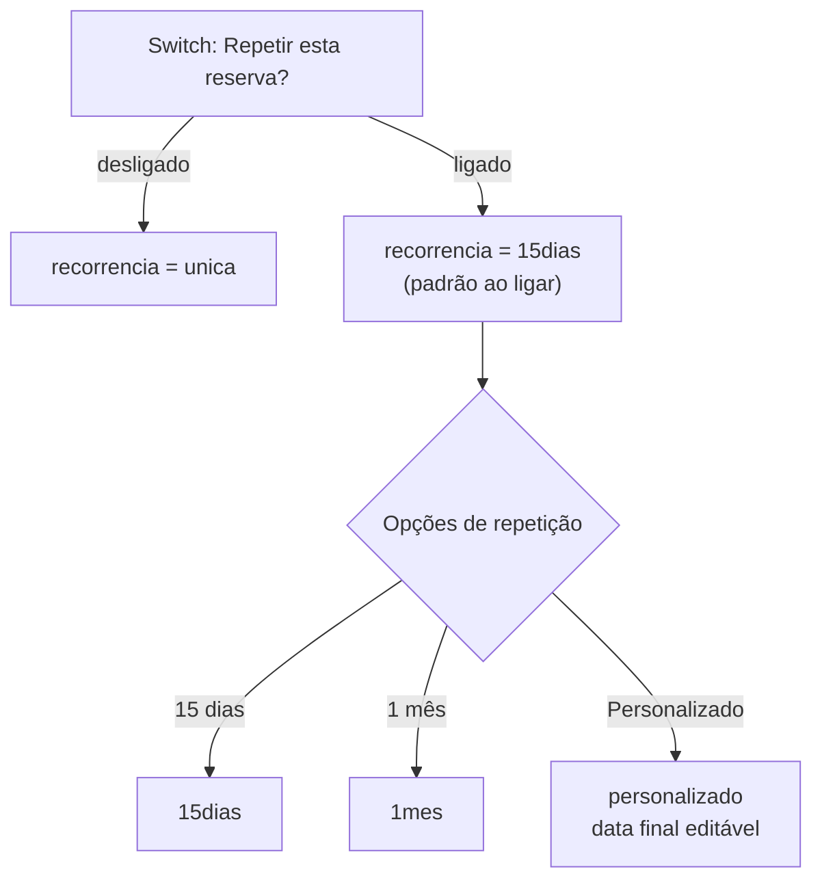
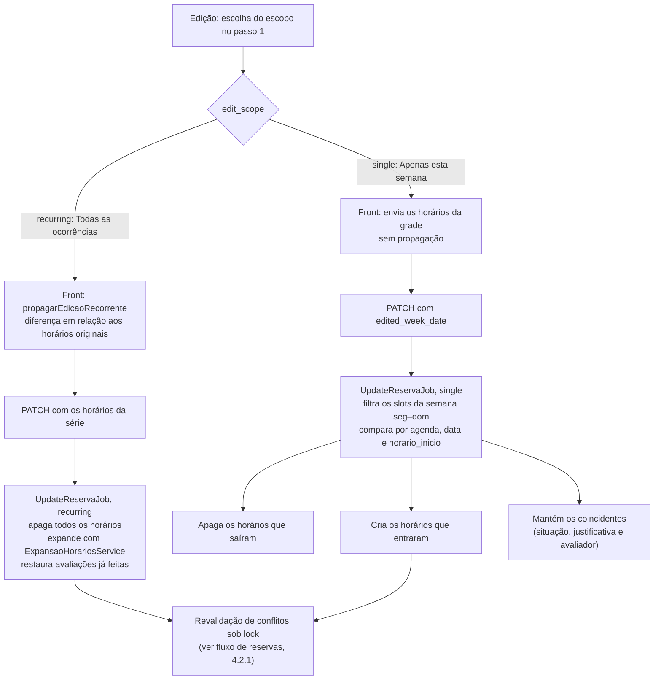

# Semântica de Recorrência — UniEspaços

## Visão Geral

Recorrência define como um padrão de horários (agenda + dia da semana + faixa horária) se expande no tempo.

- **Front:** `resources/js/constants/recorrencia.ts` calcula o `data_final` padrão de cada tipo (`calcularDataFinal`).
- **Backend:** `app/Services/ExpansaoHorariosService.php` expande os slots em linhas de `horarios`. O `StoreReservaRequest` valida `data_final` com `after_or_equal:data_inicial`, e o backend usa o `data_final` recebido na expansão.

| Tipo | Quem define `data_final` | Expansão | `data_final` editável? | Exemplo |
|------|--------------------------|----------|----------------------|---------|
| `unica` | Front: a maior data selecionada (rótulo "Apenas os horários selecionados", traduzido via i18n) | Nenhuma: grava as datas recebidas | Não | Aulas avulsas em datas da mesma semana |
| `15dias` | Front: `data_inicial` + 14 dias | Semanal até `data_final` | Não | Reunião replicada pelos próximos 15 dias |
| `1mes` | Front: `data_inicial` + 1 mês (calendário) | Semanal até `data_final` | Não | Oficina replicada por 1 mês |
| `personalizado` | **Usuário** | Semanal até `data_final` | **Sim** | Aulas em ter/qui por 3 meses |

Em **todas** as recorrências, `data_inicial` é a menor data entre os horários selecionados. Ela é derivada e somente leitura no passo 1; não é editável nem no `personalizado`. Só `data_final` pode ser editado, e só no `personalizado`.

### Como a tela escolhe o tipo

Desde 19/11/2026, o passo 1 do modal mostra o switch **"Repetir esta reserva?"** em vez de listar os quatro tipos de uma vez. O switch grava o campo `recorrencia` (`ReservaRecorrenciaField.tsx`):



A expansão e as regras desta página não mudaram. O switch só muda o que a tela envia.

---

## 1. Tipo `unica`

### Características

- **Criação:** Usuário seleciona datas e horários. Cada item de `horarios_solicitados` traz a sua `data`.
- **`data_final`:** a maior data selecionada, definida pelo hook de seleção (`use-agenda-selection.ts`). Não é editável. A constante `calcularDataFinal` de `unica` ainda soma 6 dias, mas o hook não a usa.
- **Expansão:** Nenhuma. O backend grava exatamente as datas recebidas, inclusive em semanas não contíguas (`ExpansaoHorariosService::semExpansao()`). O `data_final` não gera datas extras.
- **Banco:** N linhas em `horarios` (uma por slot único).

### Exemplo

```
Entrada:
  data_inicial: 2026-09-15
  data_final: 2026-09-15 (calculada pelo front: maior data selecionada)
  horarios_solicitados: [
    { agenda_id: 1, data: 2026-09-15, horario_inicio: 10:00, horario_fim: 11:00 },
    { agenda_id: 1, data: 2026-09-15, horario_inicio: 14:00, horario_fim: 15:00 },
  ]

Saída (horarios):
  ├─ 2026-09-15 10:00-11:00 (agenda 1)
  └─ 2026-09-15 14:00-15:00 (agenda 1)

Total: 2 horários (nenhuma expansão)
```

---

## 2. Tipo `15dias`

### Características

- **Criação:** Usuário seleciona uma data inicial e os padrões (agenda + dia da semana + horário).
- **`data_final`:** Calculada pelo front como `data_inicial` + 14 dias (`addDays(data, 14)`). Não é editável.
- **Expansão:** Semanal até `data_final` (inclusive). Cada padrão é ancorado na sua menor data selecionada e expande semanalmente enquanto não encontrar uma data futura do mesmo dia da semana com seleção explícita na requisição.
- **Banco:** N padrões × semanas até `data_final` linhas em `horarios`.

### Exemplo

```
Entrada:
  data_inicial: 2026-09-01 (terça)
  data_final: 2026-09-15 (calculada pelo front: +14 dias)
  horarios_solicitados: [
    { agenda_id: 1, data: 2026-09-01, horario_inicio: 10:00, horario_fim: 11:00 },
  ]

Saída (horarios):
  ├─ 2026-09-01 10:00-11:00 (agenda 1) — terça 1
  ├─ 2026-09-08 10:00-11:00 (agenda 1) — terça 2
  └─ 2026-09-15 10:00-11:00 (agenda 1) — terça 3

Total: 3 horários. 2026-09-22 fica fora por ser posterior a data_final.
```

---

## 3. Tipo `1mes`

### Características

- **Criação:** Usuário seleciona uma data inicial e os padrões.
- **`data_final`:** Calculada pelo front como `data_inicial` + 1 mês (`addMonths(data, 1)`). Não é editável.
- **Expansão:** Semanal até `data_final`, parando antes de qualquer semana futura do mesmo dia da semana que já possua seleção explícita na requisição.
- **Banco:** N padrões × (~4-5 semanas) linhas.

### Exemplo

```
Entrada:
  data_inicial: 2026-09-01 (terça)
  data_final: 2026-10-01 (calculada pelo front: +1 mês)
  horarios_solicitados: [
    { agenda_id: 1, data: 2026-09-01, horario_inicio: 14:00, horario_fim: 15:00 },
  ]

Saída (horarios):
  ├─ 2026-09-01 14:00-15:00 (agenda 1)
  ├─ 2026-09-08 14:00-15:00 (agenda 1)
  ├─ 2026-09-15 14:00-15:00 (agenda 1)
  ├─ 2026-09-22 14:00-15:00 (agenda 1)
  └─ 2026-09-29 14:00-15:00 (agenda 1)

Total: 5 horários. 2026-10-01 é quinta-feira, então não entra na sequência de terças.
```

---

## 4. Tipo `personalizado`

### Características

- **Criação:** Usuário seleciona os padrões (dias da semana + horários) e o `data_final`. A `data_inicial` é o menor horário selecionado e não é editável.
- **`data_final`:** Editável pelo usuário, e o sistema não calcula. O front mantém um piso: o `data_final` não fica antes do maior horário selecionado nem antes de hoje (dias anteriores ficam desabilitados no calendário), e se o usuário escolher uma data menor ela é ajustada.
- **Expansão:** Semanal até o `data_final` informado, parando antes de qualquer semana futura do mesmo dia da semana que já possua seleção explícita na requisição.
- **Frontend:** Um `DatePicker` editável (`data_final`), um somente leitura (`data_inicial`) e seleção de múltiplos dias da semana.
- **Banco:** N padrões × semanas no intervalo linhas.

### Exemplo

Mesmo cenário do teste `test_personalizado_expande_semanalmente_ate_data_final`:

```
Entrada:
  data_inicial: 2026-09-01 (terça)
  data_final: 2026-09-30 (informada pelo usuário)
  horarios_solicitados: [
    { agenda_id: 1, data: 2026-09-01, horario_inicio: 10:00, horario_fim: 11:00 }, // padrão terça
    { agenda_id: 1, data: 2026-09-03, horario_inicio: 14:00, horario_fim: 15:00 }, // padrão quinta
  ]

Saída (horarios):
  ├─ Terças: 01, 08, 15, 22, 29 de setembro (5 horários)
  └─ Quintas: 03, 10, 17, 24 de setembro (4 horários)

Total: 9 horários. A quinta 01/10 fica fora do período.
```

### Por que expande semanalmente

`15dias`, `1mes` e `personalizado` são **períodos**, não frequências. `ExpansaoHorariosService::expandindoSemanalmente()` repete cada padrão a cada 7 dias até `data_final` (ou até a semana imediatamente anterior à próxima data do mesmo dia da semana que possua seleção explícita no payload). Assim, `personalizado` segue a mesma semântica dos outros dois tipos, com o intervalo escolhido pelo usuário, e seleções explícitas por semana nunca são sobrescritas pela semana anterior. Uma seleção livre de datas avulsas não é `personalizado`; se for necessária, deve ser um novo tipo de recorrência, sem alterar este.

---

## 5. Edição de reserva: escopos

Editar uma reserva existente (`PATCH /reservas/{id}`, com `UpdateReservaRequest` e `UpdateReservaJob`) pede um escopo no passo 1 (`StepHorariosRecorrencia.tsx`):

| `edit_scope` | Rótulo na tela | O que muda | Expansão |
|---|---|---|---|
| `recurring` | "Todas as ocorrências" | A série inteira. O front propaga a diferença às demais semanas | Sim, com `ExpansaoHorariosService`, até o `data_final` da reserva |
| `single` | "Apenas esta semana" | Só a semana de `edited_week_date` (seg–dom) | Não |



### 5.1 Escopo `recurring` (Todas as ocorrências)

**Front** (`propagarEdicaoRecorrente`, em `resources/js/lib/utils/propagar-edicao-recorrente.ts`, chamado por `use-agenda-selection.ts`). Só vale quando a recorrência não é `unica`. O front compara os horários atuais com os originais da reserva e obtém os **removidos** (saíram) e os **adicionados** (entraram):

- um horário removido sai de todas as semanas com data ≥ hoje que tenham o mesmo dia da semana, a mesma agenda e o mesmo `horario_inicio`;
- um horário adicionado entra em todas as semanas do mesmo dia da semana, de `max(data_inicial, hoje)` até `data_final`;
- uma adição propagada não recria a data que o usuário removeu explicitamente;
- datas anteriores a hoje não mudam, e nada é criado fora de `data_inicial`–`data_final`.

**Backend** (`UpdateReservaJob`, escopo `recurring`):

1. Grava `titulo`, `descricao`, `recorrencia`, `data_inicial` e `data_final`.
2. Guarda as avaliações já feitas (situação, justificativa e avaliador de horários `deferida` ou `indeferida`), indexadas por `agenda_id|data|horario_inicio`.
3. Apaga todos os horários da reserva e expande o payload com `ExpansaoHorariosService::montar()`, até o `data_final` da reserva.
4. Restaura situação, justificativa e avaliador nos horários que coincidem com uma avaliação guardada.
5. Revalida conflitos com horários `deferida` de outras reservas, sob lock.

**Trade-off:** no escopo `recurring`, não é possível mudar só uma semana. Para isso, use "Apenas esta semana". A propagação segue o dia da semana, então uma troca de horário numa semana afeta as demais semanas do período, a partir de hoje.

### 5.2 Escopo `single` (Apenas esta semana)

**Front:** não propaga nada. Envia os horários da grade e `edited_week_date`, e a revisão não expande (ver 5.3).

**Backend** (`UpdateReservaJob`, escopo `single`):

1. Filtra os slots para a semana (seg–dom) de `edited_week_date`. Slots de outras semanas são ignorados.
2. Usa como identidade de cada horário a chave `agenda_id|data|horario_inicio`, que é a mesma do índice único `horarios_unique_slot_per_reserva`. Não usa `id`.
3. Compara com os horários da reserva naquela semana:
   - apaga os que saíram do payload;
   - cria os que entraram;
   - mantém os coincidentes, com situação, justificativa e avaliador preservados.
4. Não expande: grava exatamente as datas recebidas.
5. Horário novo nasce `deferida` se o dono da reserva administra a agenda (mesma regra da criação, ver [auto-aprovação](./auto-aprovacao.md)).
6. Recalcula `data_inicial` e `data_final` pelo menor e pelo maior horário restante. Se não sobrar horário, usa o período recebido.

A regra `HorarioDisponivel` valida só os slots da semana editada (ver [validação](./validacao.md#horariodisponivel)).

**Limitação atual:** a chave não inclui `horario_fim`. Mudar só o fim de um horário, mantendo o início, mantém a linha antiga. Hoje isso não ocorre, porque a grade é fixa (o início define o fim).

### 5.3 Revisão (passo 2)

`StepRevisaoConfirmacao.tsx` lista e conta os horários que serão gravados, com `expandirHorariosRecorrencia` (`resources/js/lib/utils/expandir-horarios-recorrencia.ts`). Essa função espelha o `ExpansaoHorariosService`:

- `unica` só remove duplicatas;
- as demais recorrências repetem cada slot a cada 7 dias até `data_final` (inclusive), parando antes da próxima data explícita do mesmo dia da semana.

Na edição `single`, a revisão não expande: conta só o que foi enviado para a semana.

### 5.4 Período no passo 1

- `data_inicial`: menor horário selecionado, somente leitura em todas as recorrências.
- `data_final`: somente leitura, exceto no `personalizado`.
- A data de cada horário precisa estar dentro do período: [`DataDoHorarioNoPeriodo`](./validacao.md#datadohorarionoperiodo).

---

## Histórico da hipótese H1

A auditoria levantou a hipótese de que `personalizado` deveria ser seleção livre de datas. Ela foi descartada: o comportamento atual é o pretendido, e a implementação está alinhada com a interface (intervalo editável e padrões semanais). Nenhuma alteração de implementação foi feita, e o comportamento é travado pelo teste `tests/Unit/Services/ExpansaoHorariosServiceTest.php::test_personalizado_expande_semanalmente_ate_data_final`.
