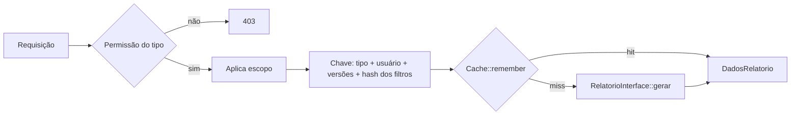

# Relatórios

Regras do módulo de relatórios: tipos disponíveis, formatos de exportação, quem gera, limites, cache e invalidação. Código em [`app/Services/Relatorio/`](../../app/Services/Relatorio/).

## 1. Tipos e formatos

Os tipos são definidos em [`TipoRelatorioEnum`](../../app/Enums/Relatorio/TipoRelatorioEnum.php). A classe de agregação de cada tipo é registrada em `config/relatorios.php` (chave `tipos`) e resolvida pela [`RelatorioFactory`](../../app/Services/Relatorio/RelatorioFactory.php).

| Tipo (`value`) | Classe de agregação | Permissão Spatie | Conteúdo |
|---|---|---|---|
| `reservas_periodo` | [`ReservasPeriodoRelatorio`](../../app/Services/Relatorio/Reports/ReservasPeriodoRelatorio.php) | `relatorios.reservas-periodo` | Uma linha por reserva (solicitante, período, situação, recorrência, total de slots). Sumário por situação. |
| `ocupacao_espacos` | [`OcupacaoEspacosRelatorio`](../../app/Services/Relatorio/Reports/OcupacaoEspacosRelatorio.php) | `relatorios.ocupacao-espacos` | Uma linha por espaço. Considera apenas horários `deferida`, contando pares distintos (data, início). |
| `inventario_espacos` | [`InventarioEspacosRelatorio`](../../app/Services/Relatorio/Reports/InventarioEspacosRelatorio.php) | `relatorios.inventario-espacos` | Uma linha por espaço (localização, nº de agendas, gestores). Sumário com capacidade total. |
| `indicadores_consolidados` | [`IndicadoresConsolidadosRelatorio`](../../app/Services/Relatorio/Reports/IndicadoresConsolidadosRelatorio.php) | `relatorios.indicadores-consolidados` | Métricas da instituição, reservas por situação, top 5 espaços e top 5 setores. |

**Taxa de ocupação** (`ocupacao_espacos`): `capacidade = dias no período, exceto domingos × soma dos slots dos turnos selecionados`, com slots por turno em `relatorios.slots_por_turno` (manhã 6, tarde 6, noite 5). `taxa = horários ocupados / capacidade × 100`. Sem datas informadas, o período é o mês corrente.

### Formatos de exportação

Definidos em [`FormatoRelatorioEnum`](../../app/Enums/Relatorio/FormatoRelatorioEnum.php) e atendidos pelos exporters em [`app/Services/Relatorio/Exporters/`](../../app/Services/Relatorio/Exporters/).

| Formato | Exporter | Implementação |
|---|---|---|
| `pdf` | [`PdfExporter`](../../app/Services/Relatorio/Exporters/PdfExporter.php) | DomPDF, view `relatorios.pdf.tabela`. Amostra de até 30 linhas (`relatorios.pdf.max_linhas_amostra`), A4, paisagem quando há mais de 6 colunas. |
| `csv` | [`CsvExporter`](../../app/Services/Relatorio/Exporters/CsvExporter.php) | Laravel Excel. Separador `;` e BOM vêm de `config/excel.php`. |
| `xlsx` | [`XlsxExporter`](../../app/Services/Relatorio/Exporters/XlsxExporter.php) | Laravel Excel, via [`RelatorioExport`](../../app/Services/Relatorio/Exports/RelatorioExport.php). Cabeçalho em negrito e formato numérico/data por coluna. |

Nome do arquivo gerado: `{tipo}-{YYYYMMDD-HHMMSS}.{formato}`.

### Quem gera

| Perfil | Controller | Prefixo de rotas | Página Inertia |
|---|---|---|---|
| Gestor | [`GestorRelatorioController`](../../app/Http/Controllers/Gestor/GestorRelatorioController.php) | `gestor/relatorios` | `Gestor/Relatorios/RelatoriosGestorPage` |
| Institucional | [`InstitucionalRelatorioController`](../../app/Http/Controllers/Institucional/InstitucionalRelatorioController.php) | `institucional/relatorios` | `Administrativo/Relatorios/RelatoriosInstitucionalPage` |

Cada controller expõe `index`, `gerar` e `dados`, todas sob o middleware `permission:secao.relatorios` ([`routes/web.php`](../../routes/web.php)). `gerar` (POST) devolve o arquivo, validado por [`GerarRelatorioRequest`](../../app/Http/Requests/Relatorio/GerarRelatorioRequest.php). `dados` (POST) devolve o agregado em JSON, sem formato, validado por [`DadosRelatorioRequest`](../../app/Http/Requests/Relatorio/DadosRelatorioRequest.php). Ambos os FormRequests autorizam o `tipo` pela permissão Spatie correspondente.

Filtros aceitos:

| Campo | Regra (FormRequests) |
|---|---|
| `tipo` | Valor de `TipoRelatorioEnum`. |
| `formato` | Só em `gerar`. Valor de `FormatoRelatorioEnum`. |
| `data_inicio`, `data_fim` | Datas opcionais. `data_fim` deve ser igual ou posterior a `data_inicio`. |
| `situacoes`, `turnos` | Arrays restritos a `SituacaoReservaEnum` e `AgendaEnum`. |
| `unidade_id`, `modulo_id`, `andar_id`, `espaco_id`, `setor_id` | Inteiros que devem existir na tabela correspondente. |

`instituicao_id` e `agenda_ids` não são regras de validação: `FiltrosRelatorio::fromArray()` os lê, mas `validated()` só repassa chaves declaradas nas regras, então a requisição não os controla. O escopo é aplicado depois (seção 2).

### Limites

- **CSV e XLSX:** máximo de **10.000 linhas** (`relatorios.limites.max_linhas_csv_xlsx`). Acima disso a resposta é HTTP 422 com a mensagem "Refine os filtros". A verificação ocorre em `gerar`, após a agregação. O endpoint `dados` não aplica esse limite.
- **PDF:** sem bloqueio por volume. O documento mostra só a amostra e informa o total omitido.
- **Período:** não há limite de intervalo de datas nos FormRequests nem no serviço.

## 2. Escopo de acesso

O conjunto de agendas e a instituição visíveis ao usuário são decididos pela [`RelatorioPolicy`](../../app/Policies/RelatorioPolicy.php). Detalhes e matriz de perfis estão em [`./autorizacao.md#escopo-dos-relatórios`](./autorizacao.md#escopo-dos-relatórios).

Em [`RelatorioService`](../../app/Services/Relatorio/RelatorioService.php), o escopo sobrescreve os filtros da requisição antes de agregar: no perfil institucional, a instituição é fixada; no perfil gestor, `agendaIds` é fixado e os filtros de unidade, módulo, andar e setor são descartados. Usuário sem nenhuma permissão de escopo recebe 403.

## 3. Cache

Fluxo de `agregarComCache` (usado por `gerar` e `dados`):



**Chave de cache** (`gerarCacheKey`), com filtros já pós-escopo e `situacoes`, `turnos` e `agendaIds` ordenados antes do hash:

```
relatorio:{tipo}:{usuario_id}:v{versao_global}.{versao_usuario}:{sha256_dos_filtros}
```

**Versionamento e invalidação:**

- `Cache::get`/`Cache::forever` guardam as versões em `relatorio_version:{tipo}` (global) e `relatorio_version:{tipo}:{usuario_id}` (por usuário). Ao invalidar, a versão é incrementada; entradas antigas deixam de ser alcançadas e expiram pelo TTL.
- Não há `Cache::tags`: o store padrão é `database` (`CACHE_STORE` em `config/cache.php`), que não suporta tags.
- TTL: `RELATORIOS_CACHE_TTL`, padrão **1800 s** (30 min), em `config/relatorios.php`.
- `invalidarCacheDoTipo($tipo, $usuarioId)` aceita invalidação por usuário, mas nenhum código de produção a chama com `$usuarioId`. Na prática, a invalidação é sempre global.

| Gatilho | Quem invalida | Tipos invalidados |
|---|---|---|
| `ReservaEvent` com ação `created`, `updated`, `evaluated` ou `canceled` | [`InvalidarCacheRelatoriosAoAtualizarReserva`](../../app/Listeners/InvalidarCacheRelatoriosAoAtualizarReserva.php) (`ShouldQueue`, registrado em `AppServiceProvider::boot()`) | `reservas_periodo`, `ocupacao_espacos`, `indicadores_consolidados` |
| `ReservaEvent` com ação `validated` | Nenhum listener de relatório | Nenhum |
| Espaço criado, atualizado, gestores atualizados ou excluído (exclusão só se a remoção ocorreu) | [`EspacoService`](../../app/Services/EspacoService.php), síncrono | `inventario_espacos` |

Como o listener roda na fila, a invalidação de reservas só acontece quando o worker processa o job.

## 4. Exportação

- **Síncrona:** a geração ocorre na própria request. CSV e XLSX usam `Excel::download`; o PDF é montado em memória e enviado com `streamDownload`. O `PdfExporter` define `memory_limit` de 512M e `set_time_limit` de 120 s.
- **Sem arquivo persistido:** o módulo não grava o relatório em disco nem em storage. Exportação assíncrona não existe; é ideia de roadmap ([`../roadmap.md`](../roadmap.md)).

**Configuração não lida pelo código:** `config/relatorios.php` define `csv.delimiter`, `csv.use_bom` e `pdf.cor_primaria`, mas nenhum código os lê. O separador e o BOM efetivos do CSV vêm de `config/excel.php`.

## 5. Testes de referência

- `tests/Feature/InstitucionalRelatoriosTest.php`
- `tests/Feature/RelatorioPolicyTest.php`
- `tests/Feature/Relatorio/RelatorioServiceCacheTest.php`
- `tests/Feature/Relatorio/RelatorioInventarioCacheTest.php`
- `tests/Unit/Services/Relatorio/RelatorioServiceScopeIsolationTest.php`

## 6. Pendências

Itens em aberto que tocam o módulo estão listados em [`../backlog.md`](../backlog.md): DEB-D2, AF-6.3a, AF-6.3b, S38, GAP-08 e I18N-F4+6a.
